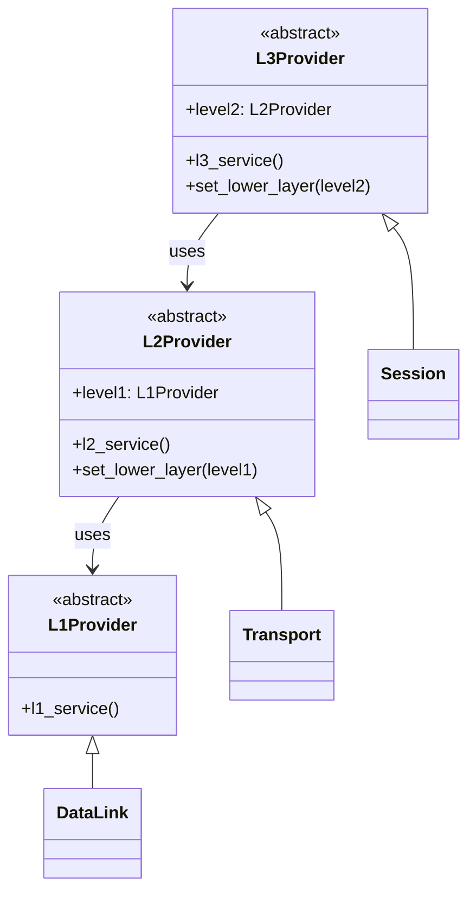

# Layered Pattern (Python)

> Java 실습(`../java/layer`, `../java/gnu-lee-se-layered-v01.pdf`)을 Python으로 옮긴 실습입니다.

## 1. Layered 패턴

시스템에서 서로 연동되는 모듈들을 모아 **계층(layer)으로 추상화**하는 패턴입니다.
위에 있는 레이어는 아래 레이어의 서비스를 사용하고, 아래 레이어는 위 레이어의 서비스를 사용할 수 없습니다.

## 2. 구조

각 추상 레이어(`L1Provider`, `L2Provider`, `L3Provider`)는 **바로 아래 레이어만** 설정(`set_lower_layer`)할 수 있습니다.
실제 레이어(`DataLink`, `Transport`, `Session`)는 추상 레이어를 상속받아 구현합니다.



### 파일 구성

| Java (`../java/layer/src/layer`) | Python (`layer/`) |
|---|---|
| `L1Provider.java` | `l1_provider.py` |
| `L2Provider.java` | `l2_provider.py` |
| `L3Provider.java` | `l3_provider.py` |
| `DataLink.java` | `data_link.py` |
| `Transport.java` | `transport.py` |
| `Session.java` | `session.py` |
| `Test.java` (main) | `main.py` |

Java의 `abstract class` 는 Python의 `abc.ABC` + `@abstractmethod` 로 표현했습니다.
(Java 쪽의 `Tranport.java` 는 오타로 남아 있는 미사용 클래스라 옮기지 않았습니다.)

## 3. 실행

Python 3.8 이상, 외부 라이브러리 필요 없음.

```bash
cd python/layer
python3 -m layer.main
```

실행 결과

```
L3Service starting its job
L2Service doing its job
L1Service doing its job
L2Service ending its job
L3Service ending its job
```

```python
def main() -> None:
    data_link = DataLink()
    transport = Transport()
    session = Session()

    transport.set_lower_layer(data_link)
    session.set_lower_layer(transport)

    session.l3_service()
```

## 4. 실습 과제

1. 코드를 **OSI 7 Layer** 구조로 수정해 보자. OSI 7 Layer는 상단부터
   `Application → Presentation → Session → Transport → Network → DataLink → Physical` 순으로 구성된다.
   (힌트: `L4Provider` ~ `L7Provider` 추상 클래스를 추가하고, 각 계층 클래스가 바로 아래 계층만 참조하도록 한다.)
2. 레이어 구조의 제약사항인 **allowed-to-use**(어떤 레이어가 어떤 레이어를 사용할 수 있는가)가
   코드에서 어떻게 표현되는지 설명해 보자.
   (힌트: `set_lower_layer` 의 파라미터 타입, 각 클래스가 보관하는 참조 필드)
3. (Python 추가) Python은 Java와 달리 타입이 강제되지 않는다. `session.set_lower_layer(data_link)` 처럼
   잘못된 레이어를 넣으면 어떻게 되는가? 실행 시점에 제약을 지키려면 어떻게 할 수 있을지
   (`isinstance` 검사, `mypy` 같은 정적 타입 검사기 등) 생각해 보자.

## 참고

- Pattern-Oriented Software Architecture Vol. 1, Addison-Wesley, 1996
