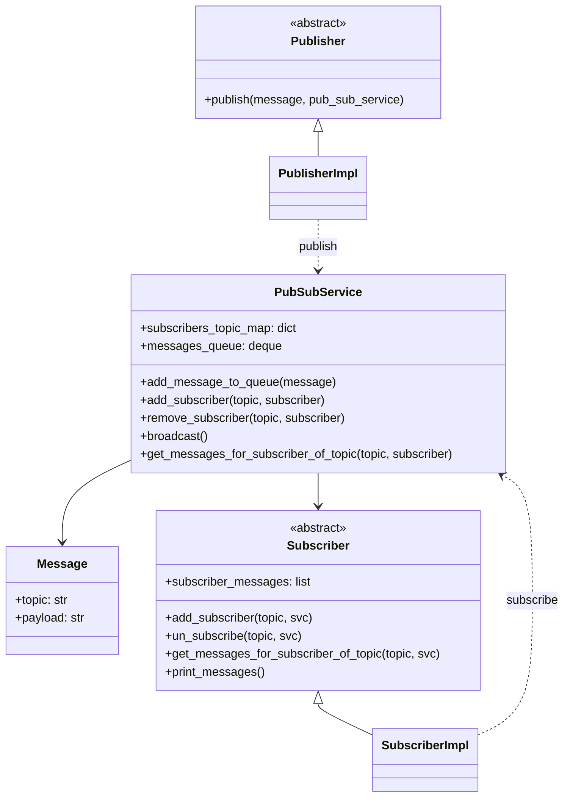

# Publisher and Subscriber Pattern (Python)

> Java 실습(`../java/exPubSub`, `../java/gnu-lee-se-pubnsub-v01.pdf`)을 Python으로 옮긴 실습입니다.

## 1. Publisher and Subscriber 패턴

게시자(Publisher)가 여러 구독자(Subscriber)에게 메시지를 보낼 때, 특정 구독자를 지정해서 보내지 않고
메시지를 **주제(topic)로 분류**해서 전달합니다. 구독자는 하나 이상의 주제에 관심을 등록해 메시지를 받습니다.
구독자 역시 게시자가 누구인지 알 필요가 없습니다. 둘 사이는 `PubSubService` 가 중개합니다.

## 2. 구조



### 파일 구성

| Java (`../java/exPubSub/src/pubsub`) | Python (`pubsub/`) |
|---|---|
| `Message.java` | `message.py` |
| `publisher/Publisher.java` | `publisher/publisher.py` |
| `publisher/PublisherImpl.java` | `publisher/publisher_impl.py` |
| `subscriber/Subscriber.java` | `subscriber/subscriber.py` |
| `subscriber/SubscriberImpl.java` | `subscriber/subscriber_impl.py` |
| `service/PubSubService.java` | `service/pub_sub_service.py` |
| `ExampleRunner.java` (main) | `example_runner.py` |

Java ↔ Python 차이

- `interface` / `abstract class` → `abc.ABC`
- `HashMap<String, Set<Subscriber>>` → `dict[str, set]`, `LinkedList` 큐 → `collections.deque`
- getter/setter 대신 속성(`message.topic`)을 직접 사용
- 순환 import를 피하려고 타입 힌트용 import는 `TYPE_CHECKING` 블록에 넣었습니다.
- Java 버전은 구독자가 없는 주제로 `broadcast()` 하면 `NullPointerException` 이 나지만, Python 버전은 해당 메시지를 버립니다.

## 3. 실행

```bash
cd python/exPubSub
python3 -m pubsub.example_runner
```

실행 결과

```
Messages of Java Subscriber are: 
Message Topic -> Java : Core Java Concepts
Message Topic -> Java : Spring MVC : Dependency Injection and AOP
```

## 4. 실습 과제

1. 지금 코드는 Java 주제에 대해서만 게시자와 구독자를 선언해 사용한다. **Python 주제**에 대한 게시자와 구독자를
   선언하고, Java 메시지를 출력하는 것과 같은 형태로 Python 관련 메시지 3개를 만들어
   게시자가 게시하면 구독자가 받아서 출력하도록 해 보자.
2. 구독자는 여러 주제를 구독할 수 있다. **두 언어를 모두 구독하는 구독자**를 선언하고,
   그 구독자를 통해 두 언어의 메시지를 모두 출력해 보자.
3. 게시자-구독자 구조로 위의 작업이 어떻게 가능한지 코드를 분석해서 설명해 보자.
   (힌트: 게시자와 구독자가 서로를 직접 참조하는 코드가 있는가?)

## 참고

- https://gist.github.com/roryokane/9606238
