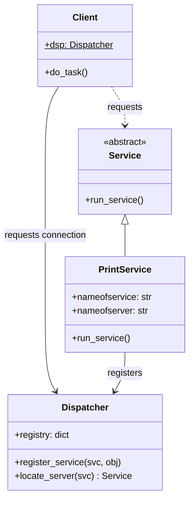

# Client-Dispatcher-Server Pattern (Python)

> Java 실습(`../java/d4Dispatcher`, `../java/gnu-lee-se-client-dispatcher-server-v02.pdf`)을 Python으로 옮긴 실습입니다.

## 1. Client-Dispatcher-Server 패턴

클라이언트와 서버 사이 통신의 세부 구현을 숨기고 **이름 서비스**를 제공하기 위해 사용합니다.

- **Client**: 도메인 작업을 수행하며, 서버가 제공하는 서비스에 접근한다.
- **Dispatcher**: Client와 Server 사이의 통신 채널을 설정한다. 서버 이름을 실제 위치(객체)와 매핑하고,
  연결을 만든 뒤 통신 제어를 클라이언트에게 넘긴다.
- **Server**: Client에 서비스를 제공하며, Dispatcher에 이름과 주소를 등록한다.

## 2. 구조



### 파일 구성

| Java (`../java/d4Dispatcher/src`) | Python |
|---|---|
| `Service.java` | `service.py` |
| `Dispatcher.java` | `dispatcher.py` |
| `Client.java` | `client.py` |
| `PrintService.java` | `print_service.py` |
| `TestClient.java` (main) | `test_client.py` |

Java ↔ Python 차이

- `Hashtable<String, Vector<Service>>` → `dict[str, list]`
- `static Dispatcher dsp` → 클래스 변수 `Client.dsp`
- Java는 `rnd.nextInt() % size` 를 쓰기 때문에 인덱스가 음수가 되어 예외가 날 수 있습니다.
  Python 버전은 `randrange(len(servers))` 로 항상 올바른 인덱스를 고릅니다.
  그래서 등록된 서버를 고르는 결과가 Java 실행 결과와 다를 수 있습니다.

## 3. 실행

```bash
cd python/d4Dispatcher
python3 test_client.py
```

실행 결과 (시드가 고정되어 있어 매번 같은 결과가 나옴)

```
Service:  printSvc by srv2
Service:  printSvc by srv1
Printer 3 Not available
```

`printSvc3` 라는 이름으로 등록된 서버가 없기 때문에 세 번째 요청은 실패합니다.

## 4. 실습 과제

1. 지금 서버의 서비스는 서비스 이름만 출력할 뿐 아무 작업도 하지 않는다.
   서비스마다 **서로 다른 언어로 인삿말**이 나오도록 수정해 보자.
2. 이 실습은 서로 다른 서버가 서비스를 제공하는 상황을 가정한다.
   `Service` 추상 클래스를 활용해 **두 개의 서비스 클래스**(`PrintService`, `PrintService2`)를 만들고
   서로 약간 다른 서비스를 제공하도록 구현해 보자.

   ```python
   def main() -> None:
       s1 = PrintService("printSvc", "srv1")
       s2 = PrintService2("printSvc", "srv2")
       client = Client()
       client.do_task()
   ```
3. 지금은 클라이언트가 하나다. **둘 이상의 클라이언트가 둘 이상의 서버에 접속**하려면
   코드에서 무엇이 바뀌어야 할지 생각해서 나열해 보자.
   (힌트: `Dispatcher` 를 클래스 변수로 공유하는 방식, 동시 접근, 서버 선택 정책 등)

## 참고

- Client-Dispatcher-Server Pattern – https://amcecmcale2014.files.wordpress.com/2015/09/client-dispatcher-serverpattern.docx
- Buschmann, F. et al. *Pattern-Oriented Software Architecture: A System of Patterns, Vol. 1*. Wiley, 2008.
