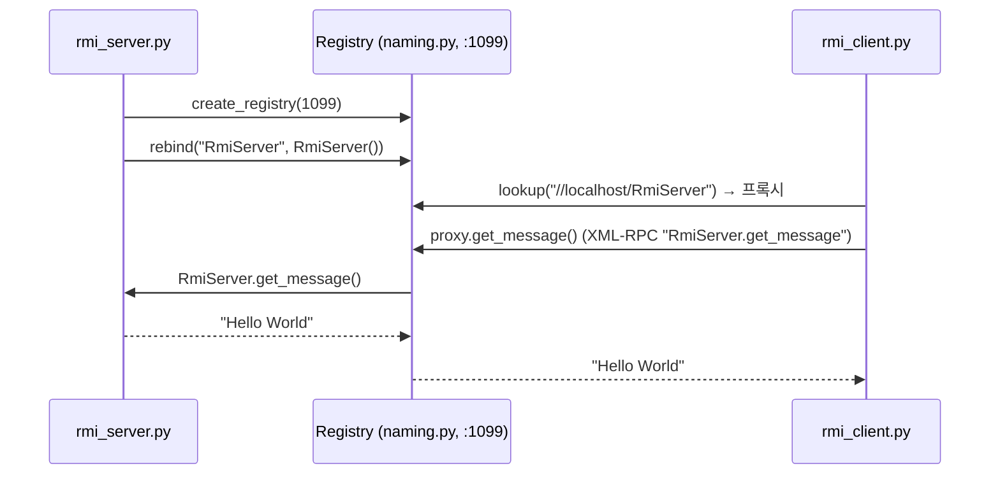

# RMI / Broker Pattern (Python)

> Java 실습(`../java/rmiex01`, `../java/gnu-lee-se-rmi-v01.pdf`)을 Python으로 옮긴 실습입니다.

## 1. RMI와 Broker 패턴

RMI 애플리케이션은 클라이언트와 서버로 구성됩니다. 서버 프로그램은 **원격 객체(remote object)** 를 만들고
그 객체에 대한 참조를 레지스트리에 등록합니다. 클라이언트는 레지스트리에서 참조를 찾아
마치 로컬 객체처럼 메서드를 호출합니다. 네트워크 통신은 중간의 **브로커(레지스트리 + 프록시)** 가 숨겨 줍니다.

Python에는 Java RMI가 없으므로, 표준 라이브러리 **`xmlrpc`** 로 같은 구조를 만들었습니다.
`naming.py` 가 Java의 `LocateRegistry` / `Naming` 역할을 합니다. 외부 라이브러리는 필요 없습니다.

## 2. 구조



### 파일 구성

| Java (`../java/rmiex01/src`) | Python |
|---|---|
| `RmiServerIntf.java` (`extends Remote`) | `rmi_server_intf.py` |
| `RmiServer.java` (`extends UnicastRemoteObject`) | `rmi_server.py` |
| `RmiClient.java` | `rmi_client.py` |
| `java.rmi.registry.LocateRegistry`, `java.rmi.Naming` | `naming.py` |

Java ↔ Python 차이

- Java는 `Remote` 인터페이스와 `RemoteException` 으로 원격 호출을 컴파일 시점에 강제합니다.
  Python의 프록시는 어떤 메서드 이름이든 호출할 수 있고, 없는 메서드는 실행 시점에 `xmlrpc.client.Fault` 오류가 납니다.
- XML-RPC는 기본 자료형(int, float, str, bool, list, dict 등)만 주고받을 수 있습니다.
  Java RMI처럼 임의의 객체를 넘기려면 [Pyro5](https://pyro5.readthedocs.io/) 같은 라이브러리를 사용합니다.

## 3. 실행

터미널 두 개를 엽니다. **서버를 먼저** 실행합니다.

```bash
# 터미널 1
cd python/rmiex01
python3 rmi_server.py
```

```
RMI server started
python RMI registry created.
PeerServer bound in registry
```

```bash
# 터미널 2
cd python/rmiex01
python3 rmi_client.py
```

```
Hello World
```

서버는 요청을 기다리며 **계속 실행 중인 상태로 멈춰 있는 것이 정상**입니다. 클라이언트를 실행하는 동안 서버 터미널을 닫거나
`Ctrl+C` 로 끄지 마세요. 서버가 꺼져 있으면 클라이언트에서 `서버에 연결할 수 없습니다` 메시지가 나옵니다.
실습이 끝나면 서버 터미널에서 `Ctrl+C` 로 종료합니다.

## 4. 실습 과제

1. 서버 쪽에 `Calculator` 객체를 구현하고, 정수 두 개를 더한 결과를 돌려주는 `add` 메서드를 추가하자.
   - `RmiCalculator` 인터페이스(추상 클래스)를 `rmi_server_intf.py` 와 비슷하게 만들고,
     `Calculator` 가 이를 구현하도록 한다.
   - 서버의 `main()` 에서 `registry.rebind("Calculator", Calculator())` 로 등록한다.
2. 클라이언트에서 `naming.lookup("//localhost/Calculator")` 로 `Calculator` 객체를 가져와
   `add` 를 실행하고 결과를 출력하자.
3. (Python 추가) 클라이언트에서 존재하지 않는 메서드(예: `server.sub(1, 2)`)를 호출하면 어떤 일이 생기는가?
   Java RMI에서는 같은 실수가 언제 발견되는지 비교해 보자.

## 참고

- An Overview of RMI Applications – https://docs.oracle.com/javase/tutorial/rmi/overview.html
- Python `xmlrpc` – https://docs.python.org/3/library/xmlrpc.html
