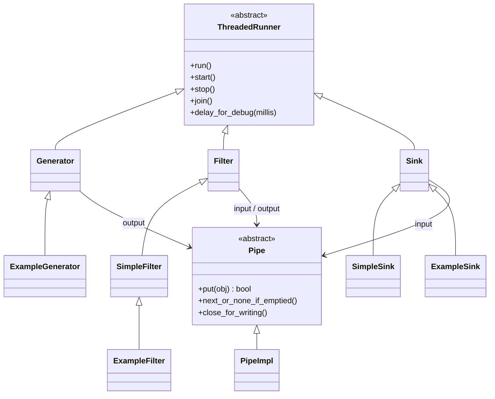

# Pipe and Filter Pattern (Python)

> Java 실습(`../java/pipenfilter`, `../java/gnu-lee-se-pipenfilter-v01.pdf`)을 Python으로 옮긴 실습입니다.

## 1. Pipe and Filter 패턴

입력 데이터 스트림을 변환할 때 사용합니다. 데이터를 처리하는 단계를 **순서대로** 처리하며,
한 필터의 결과물이 다음 필터의 입력이 됩니다. 각 처리 단계는 **파이프**로 연결합니다.

```
ExampleGenerator ──(Pipe[int])──▶ ExampleFilter ──(Pipe[str])──▶ ExampleSink
   1, 2, ..., 10                    int → str                        출력
```

## 2. 구조

각 컴포넌트(Generator, Filter, Sink)는 **각자의 스레드**에서 실행됩니다.



### 파일 구성

| Java (`../java/pipenfilter/src/pipe_foundations`) | Python (`pipe_foundations/`) |
|---|---|
| `Pipe.java` | `pipe.py` |
| `PipeImpl.java` | `pipe_impl.py` |
| `ThreadedRunner.java` | `threaded_runner.py` |
| `Generator.java` | `generator.py` |
| `Filter.java` | `filter.py` |
| `SimpleFilter.java` | `simple_filter.py` |
| `Sink.java` | `sink.py` |
| `SimpleSink.java` | `simple_sink.py` |
| `example/ExampleGenerator.java` | `example/example_generator.py` |
| `example/ExampleFilter.java` | `example/example_filter.py` |
| `example/ExampleSink.java` | `example/example_sink.py` |
| `example/ExampleRunner.java` (main) | `example/example_runner.py` |

Java ↔ Python 차이

- 제네릭 `Pipe<T>`, `Filter<I, O>` → `typing.Generic[T]`, `Generic[I, O]`
- `synchronized` + `wait()` / `notify()` → `threading.Condition`
- `null` 표시값 → `None`
- `Thread` / `Runnable` → `threading.Thread(target=self.run)`
- `while ((in = pipe.next()) != null)` → 대입 표현식 `while (item := pipe.next_or_none_if_emptied()) is not None:` (Python 3.8+)

## 3. 실행

```bash
cd python/pipenfilter
python3 -m pipe_foundations.example.example_runner
```

실행 결과 (스레드가 동시에 돌기 때문에 줄 순서는 실행할 때마다 조금씩 달라질 수 있음)

```
generated 1
filtered 1 to 1
runner finished
1
generated 2
filtered 2 to 2
generated 3
filtered 3 to 3
2
generated 4
filtered 4 to 4
3
...
generated 10
filtered 10 to 10
7
generator finished
8
9
10
sink finished
```

`runner finished` 가 앞쪽에 나오는 것에 주목하세요. main 스레드는 컴포넌트를 시작만 하고 바로 끝나며,
실제 처리는 각 컴포넌트의 스레드에서 이어집니다.

## 4. 실습 과제

1. 지금 코드는 필터를 지나면서 타입만 정수에서 문자열로 바꿀 뿐 값은 바꾸지 않는다.
   필터를 지날 때 **값이 10배**가 되도록 해 보자.
2. 필터는 한 가지 역할만 해야 한다. 문자열로 바꾸는 필터와 별도로 **값을 10배로 만드는 필터**를 만들고,
   두 필터를 파이프로 연결해 (1)과 같은 결과가 나오도록 해 보자.
   (힌트: `PipeImpl` 을 하나 더 만들어 `Generator → TimesTenFilter → ExampleFilter → Sink` 로 연결)
3. 파이프 앤 필터 구조로 위의 작업이 어떻게 가능한지 코드를 분석해서 설명해 보자.

## 참고

- https://gist.github.com/roryokane/9606238
