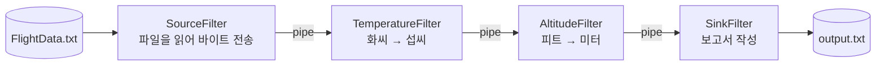
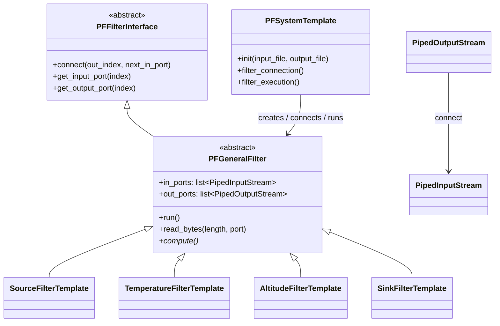

# 항공기 센서 데이터 가공 시스템 – Pipe & Filter (Python)

> Java 실습(`../java/src`, `../java/resource/FlightData.txt`)을 Python으로 옮긴 실습입니다.
> 같은 입력 파일로 실행했을 때 Java 버전과 **완전히 같은 보고서 파일**이 만들어지는 것을 확인했습니다.

## 1. 시스템 개요

항공기 센서가 기록한 이진(binary) 데이터 파일을 읽어서, 단위를 바꾸고, 사람이 읽을 수 있는 보고서로 출력하는 시스템입니다.
처리 단계마다 필터를 하나씩 두고, 필터끼리는 **파이프**로 연결합니다. 각 필터는 **별도의 스레드**에서 동시에 실행됩니다.



## 2. 입력 데이터 형식

`resource/FlightData.txt` 는 이름과 달리 텍스트가 아닌 **이진 파일**입니다. 12바이트 레코드가 이어져 있습니다 (모두 big-endian).

| 필드 | 크기 | 형식 |
|---|---|---|
| id | 4 byte | 정수 |
| measurement | 8 byte | id에 따라 다름 (아래 표) |

| id | 의미 | measurement 형식 | 이 시스템에서의 처리 |
|---|---|---|---|
| 0 | 시간 | long (epoch milliseconds) | Sink에서 날짜/시간 문자열로 출력 |
| 1 | (다른 센서 값) | double | 사용하지 않음 |
| 2 | 고도 (feet) | double | AltitudeFilter에서 미터로 변환 |
| 3 | (다른 센서 값) | double | 사용하지 않음 |
| 4 | 온도 (°F) | double | TemperatureFilter에서 섭씨로 변환 |

id 0 → 1 → 2 → 3 → 4 다섯 개가 한 프레임이고, 파일에는 100 프레임(500 레코드, 6000 바이트)이 들어 있습니다.

## 3. 구조



- **framework**: 필터와 파이프의 공통 기반. 새 필터를 만들 때 고칠 필요가 없습니다.
- **template**: 실제 필터들과, 필터를 조립하는 `PFSystemTemplate`. 실습에서 주로 고치는 곳입니다.

필터의 `run()` 은 `compute()` 를 계속 반복해서 부르다가, 입력이 끝나 `EndOfStreamException` 이 나면 자신의 포트를 닫고 끝납니다.
출력 포트가 닫히면 다음 필터의 `read()` 가 `-1` 을 받으므로, 종료가 파이프를 따라 차례로 전파됩니다.

### 파일 구성

```
python/
├── README.md
├── resource/
│   └── FlightData.txt                 # 입력 데이터 (java/resource 의 사본)
├── framework/
│   ├── piped_stream.py                # PipedInputStream / PipedOutputStream
│   ├── pf_filter_interface.py         # PFFilterInterface
│   ├── pf_general_filter.py           # PFGeneralFilter, EndOfStreamException
│   └── pf_system_main.py              # 실행 진입점 (PFSystemMain)
└── template/
    ├── constant.py                    # Constant
    ├── file_dialog.py                 # JFileChooser 대신 쓰는 파일 선택 도우미
    ├── pf_system_template.py          # PFSystemTemplate
    ├── source_filter_template.py      # SourceFilterTemplate
    ├── temperature_filter_template.py # TemperatureFilterTemplate
    ├── altitude_filter_template.py    # AltitudeFilterTemplate
    └── sink_filter_template.py        # SinkFilterTemplate
```

| Java | Python | 비고 |
|---|---|---|
| `java.io.PipedInputStream` / `PipedOutputStream` | `framework/piped_stream.py` | 표준 라이브러리에 없어서 직접 구현 (1024바이트 버퍼, 가득 차면 쓰는 쪽이 대기) |
| `PFGeneralFilter.EndOfStreamException` (내부 클래스, 생성 시 포트를 닫음) | 모듈 수준 `EndOfStreamException` | 포트 닫기는 `run()` 이 예외를 받았을 때 수행 |
| 비트 연산으로 바이트 ↔ 값 변환 (`<<`, `Double.longBitsToDouble`, `Long.rotateLeft` …) | `int.from_bytes`, `struct.unpack(">d")`, `struct.pack(">d")` | 같은 big-endian 형식 |
| 바이트를 하나씩 읽는 반복문 | `PFGeneralFilter.read_bytes(length)` | 중간에 스트림이 끝나면 `EndOfStreamException` |
| `JFileChooser` 파일 선택 창 | `template/file_dialog.py` | tkinter가 있으면 선택 창, 없으면 콘솔 입력. 명령행 인자로도 지정 가능 |
| `SimpleDateFormat("yyyy-MM-dd:hh:mm:ss")` | `strftime("%Y-%m-%d:%I:%M:%S")` | Java의 `hh` 는 12시간제라 `%I` 사용 |
| `DecimalFormat("000.00000")` | `format_decimal(value, (3, 5))` | 정수부를 최소 자릿수까지 0으로 채움 |

참고: Java `SourceFilterTemplate` 은 `available() == 0` 을 확인하는 위치 때문에 **파일의 마지막 1바이트를 보내지 않습니다**.
Python 버전은 파일 전체를 보냅니다. 이 데이터에서는 그 바이트가 소수 다섯째 자리 아래라서 보고서 결과는 같습니다.

## 4. 실행

Python 3.8 이상, 외부 라이브러리 필요 없음. **`python` 폴더에서** 실행합니다.

```bash
cd python

# 입력/출력 파일을 직접 지정
python3 -m framework.pf_system_main -i resource/FlightData.txt -o output.txt

# Java 처럼 파일 선택 창으로 지정 (tkinter 가 없으면 콘솔에서 경로를 물어봄)
python3 -m framework.pf_system_main
```

콘솔 출력 (스레드가 동시에 돌기 때문에 줄 순서는 섞여서 나옴)

```
::Source reading file...
::Temperature Reading
::Sink Reading
::Altitude Reading
::Temperature Reading
...
::Flight report is created
```

`TemperatureFilter`, `AltitudeFilter` 는 레코드 하나를 처리할 때마다 메시지를 출력하므로 각각 500번 넘게 나옵니다 (Java와 같음).

`output.txt` 결과

```
Time				Altitude	Temperature
============================================
2009-01-16:08:36:42	223.62879	-017.75074
2009-01-16:08:36:42	373.54072	-017.73823
2009-01-16:08:36:42	556.47121	-017.67177
...
2009-01-16:08:37:07	30307.47553	-006.82052
```

시간은 실행하는 컴퓨터의 시간대(timezone)로 표시되므로, 컴퓨터 설정에 따라 시각이 다르게 나올 수 있습니다 (Java도 같음).

## 5. 실습 아이디어

Java 템플릿과 같은 구조라서, Java로 하던 실습을 그대로 Python에서 해 볼 수 있습니다. 예를 들면 다음과 같습니다.

1. **필터 추가**: id 1, 3 데이터도 보고서에 출력하도록 Sink를 고치거나, 새 변환 필터를 만들어
   `PFSystemTemplate.filter_connection()` 에서 파이프라인 중간에 끼워 넣어 보자.
2. **필터 순서 바꾸기**: Temperature와 Altitude 필터의 연결 순서를 바꿔도 결과가 같은지 확인하고, 그 이유를 설명해 보자.
3. **포트 여러 개 쓰기**: `PFGeneralFilter(number_of_input_ports, number_of_output_ports)` 로 출력 포트가 2개인 필터를 만들어,
   조건에 맞는 데이터(예: 고도 10,000m 이상)를 별도 Sink로 보내 두 번째 보고서 파일을 만들어 보자.
4. Pipe & Filter 구조에서 필터를 추가하거나 바꿀 때 **다른 필터 코드를 고치지 않아도 되는 이유**를 코드를 근거로 설명해 보자.
