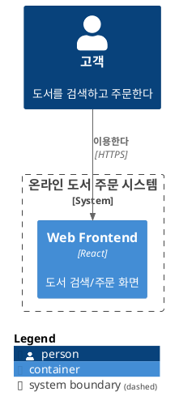

# 111. PlantUML로 C4 모델 그리기 실습

웹 브라우저만 있으면 되는 실습입니다. [PlantUML 온라인 서버](https://www.plantuml.com/plantuml)에 예제 코드를 붙여 넣고 C4 다이어그램이 그려지는 것을 확인합니다.

- 예제 출처: [C4-PlantUML README – Getting Started](https://github.com/plantuml-stdlib/C4-PlantUML#getting-started)
- 소요 시간: 약 30분
- 준비물: 인터넷이 되는 웹 브라우저 (설치할 것 없음)

---

## 0. 배경: C4 모델이란?

C4 모델은 소프트웨어 아키텍처를 **4단계 줌 레벨**로 나누어 그리는 방법입니다. 지도 앱에서 확대/축소하는 것과 비슷합니다.

| 레벨 | 다이어그램 | 무엇을 보여 주나 | C4-PlantUML include 파일 |
|---|---|---|---|
| 1 | System Context | 우리 시스템과 사용자, 외부 시스템의 관계 | `C4_Context.puml` |
| 2 | Container | 시스템 안의 실행 단위(웹앱, API, DB 등)와 기술 | `C4_Container.puml` |
| 3 | Component | 컨테이너 하나의 내부 구성 요소 | `C4_Component.puml` |
| 4 | Code | 클래스 수준 (보통 일반 UML 클래스 다이어그램 사용) | – |

**C4-PlantUML**은 PlantUML에서 C4 모델을 그릴 수 있게 해 주는 매크로 라이브러리입니다. `Person(...)`, `System(...)`, `Container(...)`, `Rel(...)` 같은 함수만 쓰면 C4 표준 모양과 색상으로 그려 줍니다.

> 상위 레벨 include 파일은 하위 레벨 요소도 쓸 수 있습니다. 예를 들어 `C4_Container.puml`을 include하면 `Person`, `System`도 함께 사용할 수 있습니다.

---

## 1. 실습 환경 준비 (PlantUML 웹 서버)

1. 브라우저에서 **https://www.plantuml.com/plantuml** 에 접속합니다.
2. 왼쪽(또는 위쪽) 텍스트 입력 칸에 있는 기본 코드(`Bob -> Alice : hello` 등)를 **모두 지웁니다**.
3. 아래 실습 코드를 **복사해서 붙여 넣습니다**.
4. 잠시 기다리면(또는 **Submit** 버튼을 누르면) 다이어그램이 그려집니다.
5. 결과 이미지 아래의 **PNG / SVG** 링크로 형식을 바꿔 볼 수 있습니다.

> 💡 모든 예제 코드는 [`examples/`](examples/) 폴더에도 `.puml` 파일로 들어 있습니다. 파일을 열어서 전체 복사해도 됩니다.

### C4 라이브러리를 불러오는 두 가지 방법

모든 C4 코드는 첫 줄 근처에 `!include`가 있어야 합니다.

```plantuml
' (A) 깃허브의 최신 버전 사용 — 실습 예제가 쓰는 방식
!include https://raw.githubusercontent.com/plantuml-stdlib/C4-PlantUML/master/C4_Container.puml

' (B) PlantUML에 내장된 표준 라이브러리 사용 — 인터넷 주소 없이 동작
!include <C4/C4_Container>
```

둘 중 하나만 쓰면 됩니다. (A)가 안 될 때는 (B)로 바꿔 보세요. 예제 2는 (B)로 바꿔도 같은 그림이 나오는 것을 확인했습니다.

---

## 실습 1. C4 기본 요소 — `examples/01_c4_elements.puml`

C4의 가장 기본 요소 세 가지(사람, 컨테이너, 시스템)와 관계(Rel)를 그려 봅니다.

```plantuml
@startuml C4_Elements
!include https://raw.githubusercontent.com/plantuml-stdlib/C4-PlantUML/master/C4_Container.puml

Person(personAlias, "Label", "Optional Description")
Container(containerAlias, "Label", "Technology", "Optional Description")
System(systemAlias, "Label", "Optional Description")

Rel(personAlias, containerAlias, "Label", "Optional Technology")
@enduml
```

**확인할 것**

- `Person`, `Container`, `System`이 각각 어떤 모양과 색으로 그려지나요?
- 매크로의 **첫 번째 인자(alias)**는 그림에 나타나지 않습니다. `Rel`에서 연결 대상을 가리키는 이름으로만 쓰입니다.
- `Container`에는 `Technology` 인자가 하나 더 있고, 그림에서는 `[Technology]`로 표시됩니다.

| 매크로 | 형식 |
|---|---|
| `Person(alias, label, ?descr)` | 사용자/역할 |
| `System(alias, label, ?descr)` | 소프트웨어 시스템 |
| `Container(alias, label, ?techn, ?descr)` | 실행 단위(앱, 서비스, DB 등) |
| `Rel(from, to, label, ?techn)` | 관계(화살표) |

**바꿔 보기**

- `Person`을 `Person_Ext`로, `System`을 `System_Ext`로 바꿔 보세요. 외부 요소는 회색으로 그려집니다.
- `Container`를 `ContainerDb`로 바꿔 보세요. 원통(DB) 모양이 됩니다.

---

## 실습 2. 경계(Boundary)가 있는 컨테이너 다이어그램 — `examples/02_basic_sample.puml`

`System_Boundary`로 "우리 시스템 안에 무엇이 있는지"를 묶어 표현합니다.

```plantuml
@startuml Basic Sample
!include https://raw.githubusercontent.com/plantuml-stdlib/C4-PlantUML/master/C4_Container.puml

Person(admin, "Administrator")
System_Boundary(c1, "Sample System") {
    Container(web_app, "Web Application", "C#, ASP.NET Core 2.1 MVC", "Allows users to compare multiple Twitter timelines")
}
System(twitter, "Twitter")

Rel(admin, web_app, "Uses", "HTTPS")
Rel(web_app, twitter, "Gets tweets from", "HTTPS")
@enduml
```

**확인할 것**

- `Sample System` 점선 경계 안에 `Web Application` 컨테이너가 들어 있습니다.
- `Twitter`는 경계 밖에 있는 다른 시스템입니다.
- 화살표 위에 관계 이름(`Uses`)과 기술(`[HTTPS]`)이 함께 표시됩니다.

**바꿔 보기**

- 경계 안에 `ContainerDb(db, "Database", "MySQL", "Stores timelines")`를 추가하고 `Rel(web_app, db, "Reads/Writes", "JDBC")`로 연결해 보세요.
- `Twitter`를 `System_Ext`로 바꿔 외부 시스템임을 드러내 보세요.
- 마지막 줄 `@enduml` 바로 위에 `SHOW_LEGEND()`를 넣어 범례를 표시해 보세요.

---

## 실습 3. 아이콘(sprite) 붙이기 — `examples/03_sprites.puml`

`$sprite` 파라미터로 요소에 기술 아이콘을 붙입니다. 아이콘은 외부 아이콘 라이브러리를 `!include`해서 가져옵니다.

```plantuml
@startuml
!include https://raw.githubusercontent.com/plantuml-stdlib/C4-PlantUML/master/C4_Container.puml

!define DEVICONS https://raw.githubusercontent.com/tupadr3/plantuml-icon-font-sprites/master/devicons
!define FONTAWESOME https://raw.githubusercontent.com/tupadr3/plantuml-icon-font-sprites/master/font-awesome-5
!include DEVICONS/angular.puml
!include DEVICONS/java.puml
!include DEVICONS/msql_server.puml
!include FONTAWESOME/users.puml

LAYOUT_WITH_LEGEND()

Person(user, "Customer", "People that need products", $sprite="users")
Container(spa, "SPA", "angular", "The main interface that the customer interacts with", $sprite="angular")
Container(api, "API", "java", "Handles all business logic", $sprite="java")
ContainerDb(db, "Database", "Microsoft SQL", "Holds product, order and invoice information", $sprite="msql_server")

Rel(user, spa, "Uses", "https")
Rel(spa, api, "Uses", "https")
Rel_R(api, db, "Reads/Writes")
@enduml
```

**확인할 것**

- 각 요소에 Angular, Java, SQL Server, 사용자 그룹 아이콘이 붙습니다.
- `$sprite="..."`처럼 **이름 붙은 인자**(`$이름=값`)를 쓰면 중간의 선택 인자를 건너뛸 수 있습니다.
- `LAYOUT_WITH_LEGEND()`로 오른쪽 아래에 범례가 생깁니다.
- `Rel_R`은 "오른쪽 방향으로" 그리는 관계입니다. `Rel_L`, `Rel_U`, `Rel_D`도 있습니다.

**바꿔 보기**

- `Rel_R(api, db, ...)`를 `Rel_D(api, db, ...)`로 바꿔서 DB 위치가 어떻게 바뀌는지 보세요.
- `LAYOUT_WITH_LEGEND()` 대신 `LAYOUT_LEFT_RIGHT()`를 넣어 전체 흐름을 가로로 바꿔 보세요.

---

## 실습 4. 링크 걸기 — `examples/04_links.puml`

`$link` 파라미터로 요소와 관계에 하이퍼링크를 겁니다. 설계 문서, 저장소, API 문서로 바로 이동하게 할 때 유용합니다.

```plantuml
@startuml Basic Sample
!include https://raw.githubusercontent.com/plantuml-stdlib/C4-PlantUML/master/C4_Container.puml

Person(admin, "Administrator", $sprite="person2", $link="https://github.com/plantuml-stdlib/C4-PlantUML/blob/master/LayoutOptions.md#hide_person_sprite-or-show_person_spritesprite")
System_Boundary(c1, "Sample System", $link="https://github.com/plantuml-stdlib/C4-PlantUML") {
    Container(web_app, "Web Application", "C#, ASP.NET Core 2.1 MVC", $descr="Allows users to compare multiple Twitter timelines", $link="https://github.com/plantuml-stdlib/C4-PlantUML/blob/master/LayoutOptions.md")
}
System(twitter, "Twitter", $link="https://github.com/plantuml-stdlib/C4-PlantUML")

Rel(admin, web_app, "Uses", "HTTPS", $link="https://plantuml.com/link")
Rel(web_app, twitter, "Gets tweets from", "HTTPS", $link="https://plantuml.com/link")
@enduml
```

**확인할 것**

- ⚠️ **PNG 이미지에서는 링크가 동작하지 않습니다.** 결과 아래의 **SVG** 링크를 눌러 SVG로 연 뒤 요소나 화살표를 클릭해 보세요.
- `$sprite="person2"`는 C4-PlantUML에 내장된 다른 사람 아이콘입니다. 실습 2의 `Administrator` 아이콘과 비교해 보세요.

**바꿔 보기**

- `Twitter`의 `$link`를 여러분이 자주 가는 사이트 주소로 바꾸고, SVG에서 클릭해 이동하는지 확인해 보세요.

---

## 실습 5. 태그와 범례 — `examples/05_tags_legend.puml`

`AddElementTag` / `AddRelTag`로 **태그별 스타일**을 정의하고, `$tags`로 요소와 관계에 붙입니다. `SHOW_LEGEND()`가 사용된 태그를 범례에 자동으로 정리합니다. 버전별 변경 사항, 백업 경로처럼 "특별한 의미"를 표시할 때 씁니다.

```plantuml
@startuml
!include https://raw.githubusercontent.com/plantuml-stdlib/C4-PlantUML/master/C4_Container.puml

AddElementTag("v1.0", $borderColor="#d73027")
AddElementTag("v1.1", $fontColor="#d73027")
AddElementTag("backup", $fontColor="orange")

AddRelTag("backup", $textColor="orange", $lineColor="orange", $lineStyle = DashedLine())

Person(user, "Customer", "People that need products")
Person(admin, "Administrator", "People that administrates the products via the new v1.1 components", $tags="v1.1")
Container(spa, "SPA", "angular", "The main interface that the customer interacts with via v1.0", $tags="v1.0")
Container(spaAdmin, "Admin SPA", "angular", "The administrator interface that the customer interacts with via new v1.1", $tags="v1.1")
Container(api, "API", "java", "Handles all business logic (incl. new v1.1 extensions)", $tags="v1.0+v1.1")
ContainerDb(db, "Database", "Microsoft SQL", "Holds product, order and invoice information")
Container(archive, "Archive", "Audit logging", "Stores 5 years", $tags="backup")

Rel(user, spa, "Uses", "https")
Rel(spa, api, "Uses", "https")
Rel_R(api, db, "Reads/Writes")
Rel(admin, spaAdmin, "Uses", "https")
Rel(spaAdmin, api, "Uses", "https")
Rel_L(api, archive, "Writes", "messages", $tags="backup")

SHOW_LEGEND()
@enduml
```

**확인할 것**

- `v1.0` 태그 요소는 **빨간 테두리**, `v1.1` 태그 요소는 **빨간 글자**로 그려집니다.
- `API`는 `$tags="v1.0+v1.1"`로 두 태그를 동시에 가집니다. 두 스타일이 합쳐져 적용됩니다.
- `backup` 관계는 **주황색 점선**으로 그려집니다.
- 범례에 각 태그가 어떤 의미인지 자동으로 표시됩니다.

**바꿔 보기**

- `AddElementTag("deprecated", $bgColor="#999999")`를 추가하고, `SPA`에 `$tags="v1.0+deprecated"`를 붙여 보세요.
- `AddRelTag`의 `DashedLine()`을 `DottedLine()` 또는 `BoldLine()`으로 바꿔 보세요.

---

## 종합 과제 (선택)

지금까지 배운 요소로 **"온라인 도서 주문 시스템"**의 컨테이너 다이어그램을 직접 그려 보세요.

- 사람: 고객, 관리자
- 시스템 경계 안: 웹 프론트엔드(React), 주문 API(Spring Boot), 주문 DB(PostgreSQL)
- 외부 시스템: 결제 대행사(PG), 이메일 발송 서비스
- 조건: 외부 시스템은 `System_Ext`, 결제 관련 관계는 태그로 강조, 범례 표시

시작 코드:



> 한글 라벨도 그대로 쓸 수 있습니다.

---

## 문제 해결

| 증상 | 원인과 해결 |
|---|---|
| `Welcome to PlantUML!` 그림만 나온다 | 코드가 비었거나 `@startuml` / `@enduml`이 빠졌습니다. 전체 코드를 다시 복사하세요. |
| `cannot include ...` 오류 | 인터넷 include 주소를 못 읽었습니다. `!include <C4/C4_Container>`로 바꿔 보세요. 실습 3의 아이콘 include는 표준 라이브러리 경로로 바꿀 수 없으니 잠시 뒤 다시 시도하세요. |
| `Syntax Error?` | 큰따옴표, 괄호, 쉼표가 빠졌는지 확인하세요. 오류가 난 줄 번호가 함께 표시됩니다. |
| 링크가 클릭되지 않는다 | PNG에서는 링크가 동작하지 않습니다. SVG로 보세요. |
| 요소 배치가 마음에 들지 않는다 | `Rel_R/L/U/D`로 방향을 지정하거나 `LAYOUT_LEFT_RIGHT()`, `LAYOUT_TOP_DOWN()`을 써 보세요. |

## 더 알아보기

- C4-PlantUML 저장소: https://github.com/plantuml-stdlib/C4-PlantUML
- 다이어그램 종류별 샘플(Context, Component, Dynamic, Deployment): https://github.com/plantuml-stdlib/C4-PlantUML/blob/master/samples/C4CoreDiagrams.md
- C4 모델 공식 사이트: https://c4model.com
