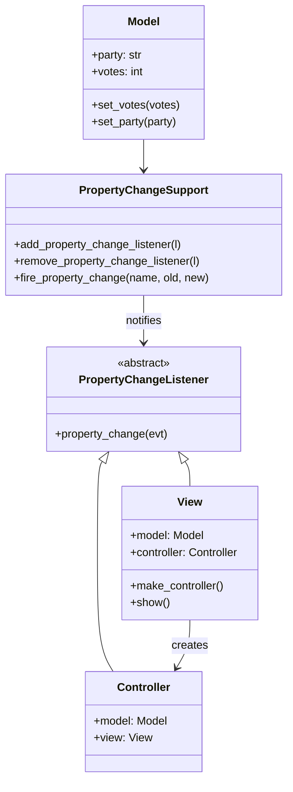

# Model-View-Controller Pattern (Python)

> Java 실습(`../java/d2mvc`, `../java/gnu-lee-se-mvc-v01.pdf`)을 Python으로 옮긴 실습입니다.

## 1. Model-View-Controller 패턴

애플리케이션의 관심사를 다음처럼 나누기 위해 사용합니다.

- **Model**: 데이터를 보관하는 객체. 데이터가 바뀔 때의 갱신 처리 로직을 포함한다.
- **View**: 모델이 가진 데이터를 화면에 보여 준다.
- **Controller**: 모델과 뷰 양쪽에 작용한다. 모델의 데이터 흐름을 처리하고, 데이터가 바뀔 때마다 뷰를 갱신하며,
  뷰와 모델의 분리를 유지한다.

## 2. 구조

Model은 `party` 와 `votes` 두 값을 가집니다. 값을 바꾸면 View와 Controller가 이를 감지합니다.
View는 바뀐 값을 출력하고, 지금 Controller는 감지한 결과만 출력합니다.



### 파일 구성

| Java (`../java/d2mvc/src/mvc`) | Python (`mvc/`) |
|---|---|
| `java.beans.PropertyChangeSupport` 등 (JDK 제공) | `property_change.py` (직접 구현) |
| `Model.java` | `model.py` |
| `View.java` | `view.py` |
| `Controller.java` | `controller.py` |
| `Test.java` (main) | `main.py` |

Python 표준 라이브러리에는 `java.beans.PropertyChangeSupport` 같은 클래스가 없어서,
`property_change.py` 에 같은 기능(옵저버 패턴)을 짧게 구현했습니다.
Java처럼 이전 값과 새 값이 같으면 알림을 보내지 않습니다.

## 3. 실행

```bash
cd python/d2mvc
python3 -m mvc.main
```

실행 결과

```
View updates the information.
* party: none
* votes: 3
the controller notices the change of the model:votes
View updates the information.
* party: black
* votes: 3
the controller notices the change of the model:party
```

## 4. 실습 과제

1. 지금 모델의 party는 `"black"`, votes는 `3` 으로 코드에 고정되어 있다. MVC 구조를 유지하면서
   **사용자 입력**으로 값을 받도록 하자. 사용자 입력은 **Controller** 에서 받는다.
   (힌트: `Controller` 에 `input()` 으로 값을 읽어 `model.set_party()`, `model.set_votes()` 를 호출하는 메서드를 추가)
2. 사용자 입력으로 값이 바뀔 때마다 상세 정보를 다시 출력하도록 하자.
3. MVC 구조로 위의 작업이 어떻게 가능한지 코드를 분석해서 설명해 보자.
4. 실제로는 콘솔보다 GUI에서 MVC 구조를 많이 쓴다. 이 구조를 GUI로 어떻게 확장할 수 있을지 예를 들어 설명해 보자.
   (Python 예: `tkinter` 의 `Entry`/`Button` 을 Controller 입력으로, `Label` 을 View 출력으로 사용)

## 참고

- MVC Pattern – https://www.tutorialspoint.com/design_pattern/mvc_pattern.htm
- The Observer Pattern in Java – https://www.baeldung.com/java-observer-pattern
