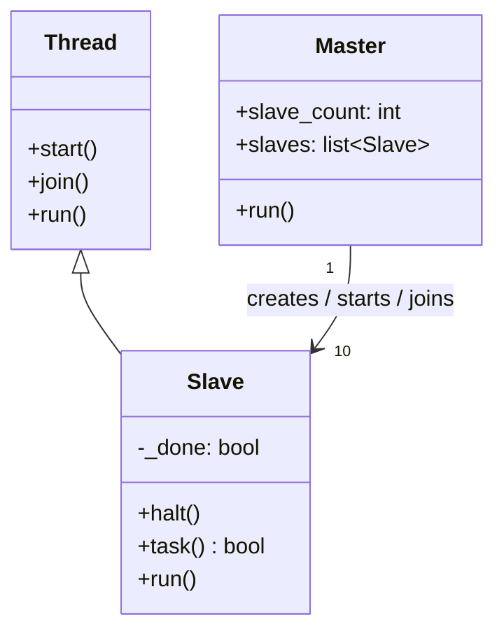

# Master-Slave Pattern (Python)

> Java 실습(`../java/d4MasterSlave1`, `../java/gnu-lee-se-master-slave-v01.pdf`)을 Python으로 옮긴 실습입니다.

## 1. Master-Slave 패턴

문제를 **분할-정복(Divide-and-Conquer)** 원칙에 따라 나누어 처리할 때 사용합니다.

- **Master**: 작업을 나누어 여러 Slave에게 맡기고, Slave가 작업을 마치면 돌려준 결과를 모아 계산한다.
- **Slave**: Master를 대신해 작업할 하위 서비스를 구현한다.

## 2. 구조

Master와 Slave는 모두 **Active Object**, 즉 각자 실행 가능한 단위입니다.
Master는 Slave(실행 단위)를 만들고 시작시킬 책임이 있습니다.



### 파일 구성

| Java (`../java/d4MasterSlave1/src`) | Python |
|---|---|
| `Slave.java` (`extends Thread`) | `slave.py` (`threading.Thread` 상속) |
| `Master.java` | `master.py` |
| `TestMaster.java` (main) | `test_master.py` |

Java ↔ Python 차이

- `Thread.sleep(1000)` → `time.sleep(1)`
- Java 스레드 이름(`Thread-0` …)과 맞추기 위해 Slave를 만들 때 `name=f"Thread-{i}"` 를 지정했습니다.
- Python(CPython)은 GIL 때문에 CPU 계산 작업을 스레드로 나눠도 동시에 실행되지 않습니다.
  계산량이 큰 작업을 실제로 병렬 처리하려면 `multiprocessing` 또는 `concurrent.futures.ProcessPoolExecutor` 를 사용합니다.

## 3. 실행

```bash
cd python/d4MasterSlave1
python3 test_master.py
```

실행 결과 (약 1초 후)

```
Thread-0 has died
Thread-1 has died
...
Thread-9 has died
The master will now die ... 
```

## 4. 실습 과제

1. 지금 Master는 Slave 10개를 만든다. **1부터 100까지**를 Slave 10개에 나누어 맡기고(예: 1~10, 11~20, …),
   각 Slave가 계산한 부분합을 Master가 모아 **전체 합(5050)** 을 출력하도록 수정해 보자.
   (힌트: `Slave.__init__` 에서 시작값과 끝값을 받고, `task()` 에서 합을 계산해 `self.result` 에 저장한 뒤,
   Master가 `join()` 후에 `slave.result` 를 더한다.)
2. (Python 추가) 같은 작업을 `concurrent.futures.ThreadPoolExecutor` 로 다시 작성해 보고,
   직접 `Thread` 를 다루는 방식과 무엇이 다른지 비교해 보자.

## 참고

- Master-Slave Pattern – http://www.cs.sjsu.edu/~pearce/modules/lectures/oop/templates/threads/index.htm
