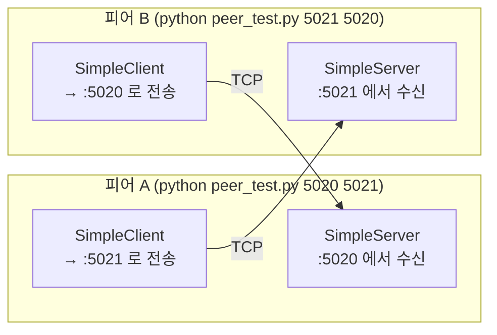

# Peer to Peer Pattern (Python)

> Java 실습(`../java/peer2peer`, `../java/gnu-lee-se-p2p-v01.pdf`)을 Python으로 옮긴 실습입니다.

## 1. Peer to Peer 패턴

Peer to Peer 패턴은 **대칭적인 클라이언트-서버 패턴**입니다. 하나의 시스템(피어)이 클라이언트와 서버 역할을
동시에 합니다. 즉, 요청을 보낼 수도 있고 동시에 요청에 대한 서비스를 제공할 수도 있습니다.

## 2. 구조

각 피어는 **서버 스레드**(상대가 보낸 메시지를 받아 출력)와 **클라이언트 스레드**(내가 입력한 메시지를 상대에게 전송)를
함께 실행합니다. 두 피어는 서로의 받는 포트와 보내는 포트를 맞바꿔 사용합니다.



### 파일 구성

| Java (`../java/peer2peer/src/peer2peer`) | Python |
|---|---|
| `SimpleServer.java` | `simple_server.py` |
| `SimpleClient.java` | `simple_client.py` |
| `PeerTest.java` (main) | `peer_test.py` |

Java ↔ Python 차이

- `ServerSocket` / `Socket` → `socket` 모듈, `BufferedReader` / `BufferedWriter` → `socket.makefile()`
- `Scanner(System.in).nextLine()` → `input()`
- `System.exit(0)` → `os._exit(0)` (다른 스레드가 남아 있어도 프로세스를 바로 끝냄)
- Java 버전은 상대 피어용으로 프로젝트를 복사한 뒤 **코드의 포트 번호를 바꿔야** 했습니다.
  Python 버전은 포트를 **명령행 인자**로 받으므로 같은 코드를 그대로 두 번 실행하면 됩니다.
- Java 버전은 두 피어를 3초 안에 모두 실행해야 연결됩니다. Python 버전 클라이언트는 상대 서버가 뜰 때까지
  최대 30초 동안 1초 간격으로 다시 연결을 시도합니다.

## 3. 실행

터미널 두 개를 엽니다.

```bash
# 터미널 1 (피어 A)
cd python/peer2peer
python3 peer_test.py 5020 5021
```

```bash
# 터미널 2 (피어 B)
cd python/peer2peer
python3 peer_test.py 5021 5020
```

연결되면 양쪽에 `Connected!` 가 출력됩니다. 한쪽에서 메시지를 입력하고 Enter를 누르면 다른 쪽에 출력됩니다.

```
# 피어 A 에서 입력        # 피어 B 화면
hello                     Peer: hello
```

한쪽에서 `exit` 를 입력하면 그 피어가 종료되고, 상대 피어도 `exit` 메시지를 받아 함께 종료됩니다.

## 4. 실습 과제

1. 위 순서대로 두 피어를 실행하고 피어 간 채팅을 해 보자.
2. 이 구조에서 각 피어가 클라이언트이면서 동시에 서버인 이유를 코드를 근거로 설명해 보자.
   일반적인 클라이언트-서버 구조와 무엇이 다른가?
3. (확장) 지금은 피어가 정확히 두 개다. 세 개 이상의 피어가 서로 대화하려면 무엇을 바꿔야 할지 생각해 보자.
   (힌트: 서버가 여러 연결을 받으려면 `accept()` 를 반복하고 연결마다 스레드를 만들어야 한다.
   클라이언트는 여러 피어의 주소 목록을 가져야 한다.)

## 참고

- https://gist.github.com/roryokane/9606238
