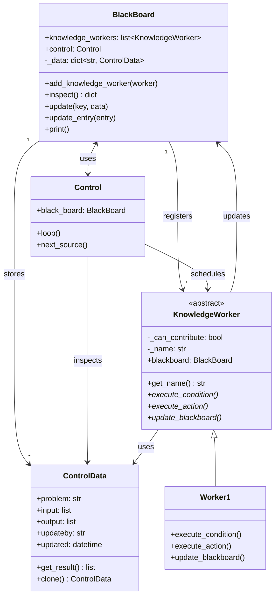

# Blackboard Pattern (Python)

> Java 실습(`../java/d4Blackboard2`, `../java/gnu-lee-se-ap04-blackboard-v01.pdf`)을 Python으로 옮긴 실습입니다.

## 1. Blackboard 패턴

문제에 대해서 전문가적인 지식을 가진 각각의 컴포넌트들이 칠판(Blackboard)에 자신의 지식을 적용합니다.

- **Blackboard**: 중앙 데이터를 관리한다.
- **KnowledgeWorker**: 지식 적용이 가능한지 평가하여, 처리하고, 중앙 데이터를 업데이트한다.
- **Control**: KnowledgeWorker의 동작을 스케줄링한다.

## 2. 구조

BlackBoard와 ControlData가 저장소에 있는 파트입니다. ControlData의 정보에 의해 Control이 다음에 수행할
KnowledgeWorker를 정합니다. 선정된 KnowledgeWorker는 자신이 수행할 조건인지를 체크하고, 해당 조건인 경우
BlackBoard에 있는 데이터에 대하여 자신의 작업을 수행합니다.



### 파일 구성

| Java (`../java/d4Blackboard2/src/blackboard`) | Python (`blackboard/`) |
|---|---|
| `BlackBoard.java` | `black_board.py` |
| `ControlData.java` | `control_data.py` |
| `Control.java` | `control.py` |
| `KnowledgeWorker.java` (abstract class) | `knowledge_worker.py` (`abc.ABC` 상속) |
| `Worker1.java` | `worker1.py` |
| `TestBlackBoard.java` (main) | `test_black_board.py` |

Java ↔ Python 차이

- `Hashtable` → `dict`, `LinkedList` → `list`, `Object[]` → `list`, `Date` → `datetime`
- Python에는 메서드 오버로딩이 없습니다.
  - `update(Entry)` 는 `update_entry((key, data))` 로 이름을 나누었습니다. (`update(key, data)` 는 그대로)
  - 생성자 두 개는 기본값 인자 하나로 합쳤습니다. 따라서 Worker는 `Worker1("PrimeFinder", board)` 처럼
    **이름을 먼저** 넘기고, 칠판은 생략할 수 있습니다.
- Java의 `problem == "PrimeNumbers"` 는 문자열의 참조를 비교하므로 리터럴이 아닌 문자열에서는 틀릴 수 있습니다.
  Python의 `==` 는 값을 비교합니다.
- Java의 `String.format("data:{0}", ...)` 는 `{0}` 을 그대로 출력합니다. Python 버전은 f-string을 사용하므로
  `print()` 가 실제 값을 출력합니다.

## 3. 실행

```bash
cd python/d4Blackboard2
python3 -m blackboard.test_black_board
```

실행 결과

```
Starting loop
Knowledge Worker Found
Worker1-executeCondition
Worker1-executeAction
Worker1-updateBlackboard
Loop ended
```

## 4. 실습 과제

1. 코드 템플릿에 있는 `Worker1` 은 배열의 수 중 **소수를 선택하는** KnowledgeWorker인데, `execute_condition`,
   `execute_action`, `update_blackboard` 에는 이러한 기능이 구현되어 있지 않다. 기능을 구현해 보자.
   (힌트: `execute_condition` 에서 `self.blackboard.inspect()` 로 데이터를 꺼내 `self._keys` 에 담고
   처리할 수 있는지를 `self._can_contribute` 에 기록한다. `execute_action` 은 그 값이 참일 때만 소수를 골라
   `ControlData.output` 에 저장한다. `update_blackboard` 는 `updateby`, `updated` 를 채운 뒤 `blackboard.update()` 를
   호출한다. 결과는 `board.print()` 로 확인한다. 1은 소수가 아니다.)
2. `Worker2` 를 만들자. `Worker2` 는 배열의 수 중 **짝수를 선택하는** KnowledgeWorker이다.
   `Worker1` 이 작업한 결과로서의 배열에서 짝수를 선택하도록 `Worker2` 의 기능을 구현해 보자.
   (힌트: 지금 `Control.next_source()` 는 `"PrimeFinder"` 만 실행한다. `Worker2` 도 실행되도록 Control을 고치고,
   `Worker2` 는 `output` 이 채워졌을 때만 기여할 수 있다고 판단한다.
   `[1, ..., 10]` 의 최종 결과는 소수 `2, 3, 5, 7` 중 짝수인 `2` 이다.)
3. 구조를 파악하여 설명을 해 보자.

## 참고

- Blackboard Pattern – https://riptutorial.com/design-patterns/example/22355/csharp-sample
