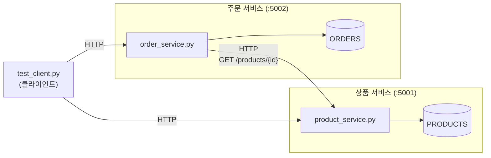

# Microservice Pattern (Python)

> 다른 실습과 달리 Java 실습과 PDF 없이 Python으로만 작성한 실습입니다. 표준 라이브러리만 사용합니다.

## 1. Microservice 패턴

애플리케이션을 **독립적으로 실행되고 배포되는 작은 서비스들**로 나눕니다.

- **Service**: 하나의 업무 기능을 맡는 독립 프로세스. 다른 서비스와 상관없이 수정하고 다시 배포할 수 있다.
- **API**: 서비스끼리는 네트워크(HTTP)로 공개된 API를 통해서만 통신한다.
- **자체 데이터**: 각 서비스는 자기 데이터를 소유한다. 다른 서비스의 데이터는 직접 읽지 않고 API로 요청한다.

| | 모놀리식 | 마이크로서비스 |
|---|---|---|
| 실행 단위 | 프로세스 하나 | 서비스마다 프로세스 하나 |
| 기능 호출 | 함수 호출 | 네트워크 호출 |
| 수정 후 배포 | 전체를 다시 배포 | 바뀐 서비스만 다시 배포 |
| 일부 장애 | 전체가 멈출 수 있음 | 장애가 난 기능만 멈추도록 만들 수 있음 |

## 2. 구조

주문 서비스는 주문 금액을 계산할 때 상품 서비스의 API를 호출해 가격을 얻습니다.
`PRODUCTS` 를 직접 import 하지 않습니다.



### 파일 구성

| 파일 | 역할 |
|---|---|
| `product_service.py` | 상품 서비스 (포트 5001) |
| `order_service.py` | 주문 서비스 (포트 5002) |
| `test_client.py` | 두 서비스를 호출해 보는 클라이언트 |

### API

| 서비스 | 요청 | 설명 |
|---|---|---|
| 상품 | `GET /products` | 상품 목록 |
| 상품 | `GET /products/{id}` | 상품 한 개 (없으면 404) |
| 주문 | `GET /orders` | 주문 목록 |
| 주문 | `POST /orders` | 주문 생성. 본문 `{"product_id": 1, "quantity": 2}` |

실습을 단순하게 하려고 데이터를 메모리에만 저장합니다. 서비스를 다시 시작하면 주문 목록은 비워집니다.
`_send_json` 이 두 서비스에 중복되어 있는 것은 의도한 것입니다. 서비스끼리 코드를 공유하지 않아야
서로 독립적으로 수정하고 배포할 수 있기 때문입니다.

## 3. 실행

터미널 세 개를 엽니다.

```bash
# 터미널 1 (상품 서비스)
cd python/microservice
python product_service.py
```

```bash
# 터미널 2 (주문 서비스)
cd python/microservice
python order_service.py
```

```bash
# 터미널 3 (클라이언트)
cd python/microservice
python test_client.py
```

실행 결과 (터미널 3)

```
GET http://localhost:5001/products
  200 [{"id": 1, "name": "keyboard", "price": 30000}, {"id": 2, "name": "mouse", "price": 15000}]
POST http://localhost:5002/orders {"product_id": 1, "quantity": 2}
  201 {"id": 1, "product_id": 1, "quantity": 2, "total_price": 60000}
POST http://localhost:5002/orders {"product_id": 99, "quantity": 1}
  404 {"error": "product not found"}
GET http://localhost:5002/orders
  200 [{"id": 1, "product_id": 1, "quantity": 2, "total_price": 60000}]
```

터미널 2의 요청 로그와 터미널 1의 요청 로그를 비교하면, 주문 한 건마다 주문 서비스가 상품 서비스를 호출하는 것을 볼 수 있습니다.
각 서비스는 Ctrl+C 로 종료합니다.

## 4. 실습 과제

1. **상품 서비스만 수정하기**: `product_service.py` 의 `PRODUCTS` 에 3번 상품을 추가해 보자.
   상품 서비스만 다시 시작한 뒤 `test_client.py` 를 실행해서 목록에 나타나는지 확인한다.
   주문 서비스는 수정하지도, 다시 시작하지도 않는다.
   ```python
   3: {"id": 3, "name": "monitor", "price": 200000},
   ```
2. **주문 서비스만 수정하기**: `order_service.py` 에서 주문을 만들 때 `order` 에 상품 이름을 추가해 보자.
   주문 서비스만 다시 시작한 뒤 주문 응답에 `product_name` 이 있는지 확인한다.
   ```python
   "product_name": product["name"],
   ```
3. **장애 격리 확인하기**: 터미널 1에서 상품 서비스를 종료하고 `test_client.py` 를 실행해 보자.
   `POST /orders` 는 `503` 을 돌려주지만 `GET /orders` 는 계속 동작한다. 왜 그런지 코드를 근거로 설명해 보자.
4. 과제 1과 2에서 수정한 범위를 바탕으로, 이 구조의 장점을 설명해 보자.
   함수 호출 대신 네트워크 호출을 사용해서 생기는 단점은 무엇인가?

## 참고

- Microservices – https://martinfowler.com/articles/microservices.html
- Microservice Architecture pattern – https://microservices.io/patterns/microservices.html
