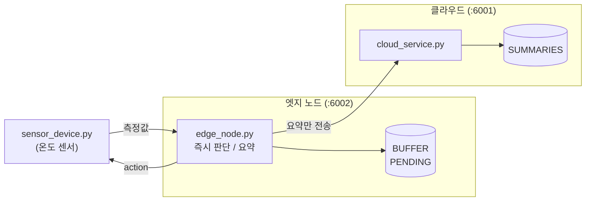

# Edge-based Architecture Pattern (Python)

> 다른 실습과 달리 Java 실습과 PDF 없이 Python으로만 작성한 실습입니다. 표준 라이브러리만 사용합니다.

## 1. Edge-based 패턴

모든 데이터를 멀리 있는 클라우드로 보내 처리하는 대신, **데이터가 생기는 곳 가까이(엣지)** 에서 먼저 처리합니다.

- **Device**: 데이터를 만드는 장치. 이 실습에서는 온도 센서이다.
- **Edge Node**: 장치 가까이에서 데이터를 처리한다. 즉시 판단하고, 데이터를 요약해서 클라우드로 보낸다.
- **Cloud**: 여러 엣지의 요약 데이터를 모아 저장하고 전체 현황을 제공한다.

| | 클라우드 집중 처리 | 엣지 처리 |
|---|---|---|
| 판단 위치 | 클라우드 | 장치 가까이의 엣지 노드 |
| 응답 시간 | 네트워크 왕복만큼 늦음 | 빠름 |
| 전송 데이터 | 측정값 전체 | 요약만 |
| 클라우드 연결 끊김 | 판단할 수 없음 | 엣지가 판단을 계속함 |

## 2. 구조

센서는 측정값을 엣지 노드로 보내고, 엣지 노드는 냉각 장치를 켤지 바로 판단해 응답합니다.
측정값이 5개 모이면 요약(개수, 평균, 최댓값)을 만들어 클라우드로 보냅니다.
클라우드에 연결되지 않으면 요약을 `PENDING` 에 보관했다가, 다음 요약을 보낼 때 순서대로 함께 보냅니다.



### 파일 구성

| 파일 | 역할 |
|---|---|
| `sensor_device.py` | 측정값 10개를 보내고 결과를 확인하는 센서 |
| `edge_node.py` | 엣지 노드 (포트 6002) |
| `cloud_service.py` | 클라우드 서비스 (포트 6001) |

### API

| 서비스 | 요청 | 설명 |
|---|---|---|
| 엣지 | `POST /readings` | 측정값 전달. 본문 `{"temperature": 31.5}`. 응답의 `action` 이 판단 결과 |
| 엣지 | `GET /status` | 요약 전 측정값 수(`buffered`), 전송 대기 요약 수(`pending`) |
| 클라우드 | `POST /summaries` | 요약 저장 |
| 클라우드 | `GET /summaries` | 요약 목록 |

실습을 단순하게 하려고 데이터를 메모리에만 저장합니다. 서비스를 다시 시작하면 저장된 데이터는 비워집니다.
실제 시스템이라면 엣지 노드가 꺼져도 `PENDING` 을 잃지 않도록 파일 등에 저장합니다.

## 3. 실행

터미널 세 개를 엽니다.

```bash
# 터미널 1 (클라우드)
cd python/edge
python3 cloud_service.py
```

```bash
# 터미널 2 (엣지 노드)
cd python/edge
python3 edge_node.py
```

```bash
# 터미널 3 (센서)
cd python/edge
python3 sensor_device.py
```

실행 결과 (터미널 3, 가운데 일부 생략)

```
POST http://localhost:6002/readings {"temperature": 24.0}
  200 {"temperature": 24.0, "action": "none"}
...
POST http://localhost:6002/readings {"temperature": 31.5}
  200 {"temperature": 31.5, "action": "cooling_on"}
...
GET http://localhost:6002/status
  200 {"buffered": 0, "pending": 0}
GET http://localhost:6001/summaries
  200 [{"count": 5, "average": 26.8, "max": 31.5}, {"count": 5, "average": 27.0, "max": 33.0}]
```

측정값 10개가 요약 2개가 되어 클라우드에 도착했습니다. 온도가 30.0을 넘은 측정값에는 `cooling_on` 을 응답했습니다.

## 4. 실습 과제

과제는 차례대로 진행합니다. `sensor_device.py` 는 실행할 때마다 측정값 10개를 보내므로
클라우드에는 요약이 누적됩니다.

1. **엣지의 판단 기준 바꾸기**: `edge_node.py` 의 기준 온도를 바꿔 보자. 엣지 노드만 다시 시작한 뒤
   `sensor_device.py` 를 실행해서 `cooling_on` 이 4번 나오는지 확인한다. 클라우드는 수정하지 않는다.
   ```python
   TEMPERATURE_LIMIT = 26.0
   ```
2. **요약 항목 추가하기**: `edge_node.py` 의 `summarize()` 에 최솟값을 추가해 보자.
   엣지 노드만 다시 시작한 뒤 클라우드의 새 요약에 `min` 이 있는지 확인한다.
   ```python
   "min": min(temperatures),
   ```
3. **클라우드 연결 끊기**: 터미널 1에서 클라우드를 종료하고 `sensor_device.py` 를 실행해 보자.
   센서는 계속 `action` 을 응답받고, `/status` 의 `pending` 이 `2` 가 된다.
   클라우드를 다시 시작하고 한 번 더 실행하면 `pending` 이 `0` 이 되고, 보관했던 요약 2개와 새 요약 2개가 클라우드에 도착한다.
   이 동작을 `store_reading()` 과 `flush_pending()` 코드를 근거로 설명해 보자.
4. 15micro의 주문 서비스는 상품 서비스가 멈추면 주문을 만들지 못했다. 이 실습의 엣지 노드는 클라우드가 멈춰도
   계속 동작한다. 두 구조의 차이가 무엇인지, 어떤 판단을 엣지에 두고 어떤 판단을 클라우드에 두어야 하는지 설명해 보자.

## 참고

- Edge computing – https://en.wikipedia.org/wiki/Edge_computing
