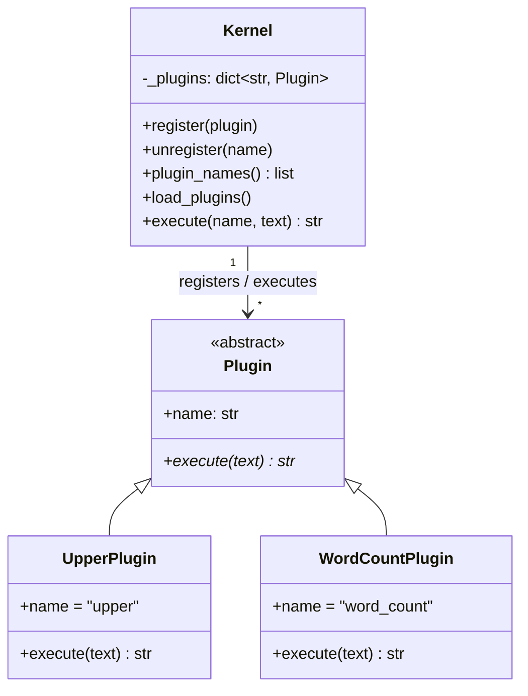

# Microkernel Pattern (Python)

> 다른 실습과 달리 Java 실습과 PDF 없이 Python으로만 작성한 실습입니다. 표준 라이브러리만 사용합니다.

## 1. Microkernel 패턴

시스템을 **최소한의 코어**와 **교체할 수 있는 플러그인**으로 나눕니다. 플러그인 아키텍처라고도 합니다.

- **Core System**: 플러그인을 찾아 등록하고 실행하는 공통 기능만 가진다. 개별 업무 기능은 알지 못한다.
- **Plug-in**: 기능 하나를 독립적으로 구현한다. 다른 플러그인에 의존하지 않는다.
- **Plug-in Interface**: 코어와 플러그인 사이의 약속. 코어는 이 인터페이스를 통해서만 플러그인을 사용한다.

웹 브라우저의 확장 프로그램, VS Code의 익스텐션이 같은 구조의 예입니다.

## 2. 구조

`Kernel` 은 시작할 때 `plugins` 폴더를 살펴보고 `Plugin` 을 상속한 클래스를 찾아 등록합니다.
코드 어디에도 `UpperPlugin` 같은 구체 클래스 이름이 없으므로, 플러그인을 추가할 때 코어를 고치지 않습니다.



### 파일 구성

| 파일 | 역할 |
|---|---|
| `kernel.py` | 코어 시스템 |
| `plugin.py` | 플러그인 인터페이스 |
| `plugins/upper.py` | 대문자로 바꾸는 플러그인 |
| `plugins/word_count.py` | 단어 수를 세는 플러그인 |
| `main.py` | 실행 진입점 |

플러그인 탐색에는 표준 라이브러리의 `pkgutil.iter_modules()` 와 `importlib.import_module()` 을 사용합니다.

## 3. 실행

```bash
cd python/microkernel
python main.py
```

실행 결과

```
plugins: ['upper', 'word_count']
input: hello micro kernel
upper: HELLO MICRO KERNEL
word_count: 3
translate: error: unknown plugin 'translate'
```

`translate` 는 일부러 호출한 없는 플러그인입니다. 등록되지 않은 플러그인을 호출해도 코어는 오류 메시지만 돌려주고 계속 동작합니다.

## 4. 실습 과제

1. **플러그인 추가하기**: `plugins/reverse.py` 를 만들어 보자. `kernel.py` 와 `main.py` 는 수정하지 않는다.
   실행하면 `plugins` 목록에 `reverse` 가 나타나고 `reverse: lenrek orcim olleh` 가 출력된다.
   ```python
   from plugin import Plugin


   class ReversePlugin(Plugin):
       name = "reverse"

       def execute(self, text: str) -> str:
           return text[::-1]
   ```
2. **플러그인 제거하기**: `plugins/word_count.py` 를 지우거나 다른 폴더로 옮기고 실행해 보자.
   코어를 고치지 않아도 나머지 플러그인은 그대로 동작한다.
3. **장애 격리 확인하기**: `execute()` 에서 `return str(1 / 0)` 을 실행하는 `plugins/broken.py` 를 만들어 보자.
   `broken: error: plugin 'broken' failed: division by zero` 가 출력되고 다른 플러그인은 계속 동작한다.
   어느 코드 덕분인지 설명해 보자.
4. 이 구조를 15micro의 마이크로서비스와 비교해 보자. 기능을 나누는 방식은 비슷하지만 실행 단위와 호출 방식은
   무엇이 다른가? 이 실습의 플러그인이 `while True: pass` 처럼 끝나지 않는다면 코어는 어떻게 될까?

## 참고

- Mark Richards, *Software Architecture Patterns* (O'Reilly) – Microkernel Architecture 장
- Creating and discovering plugins – https://packaging.python.org/en/latest/guides/creating-and-discovering-plugins/
