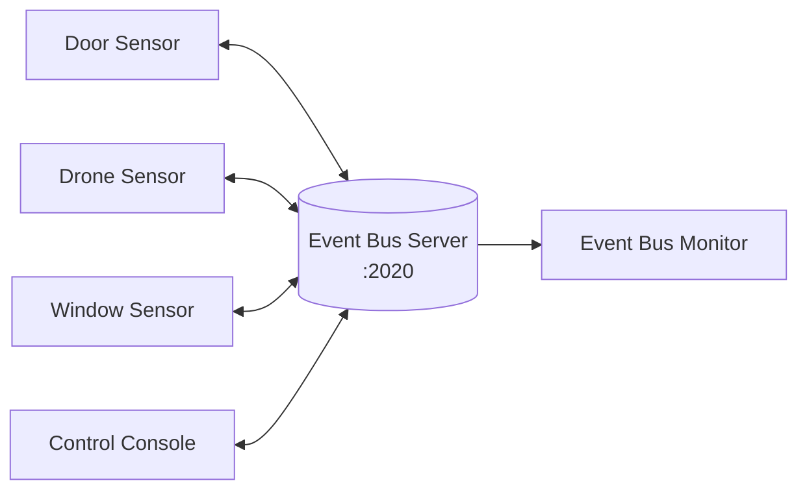
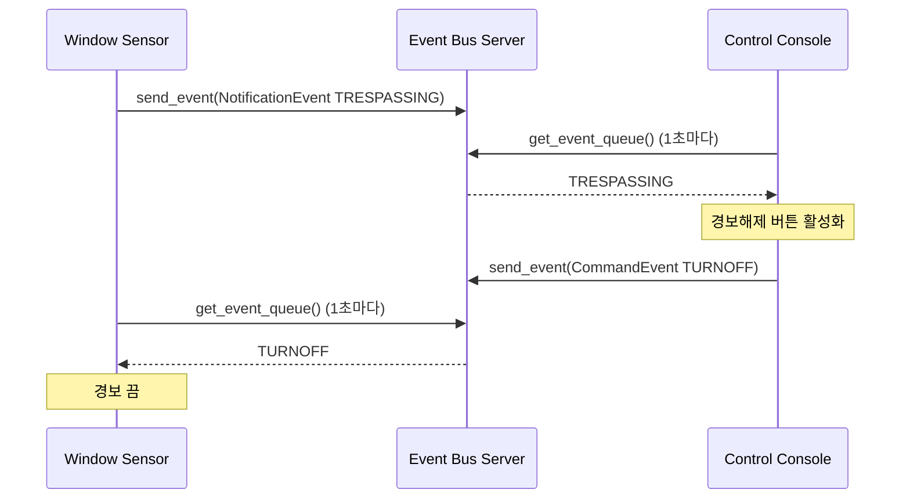
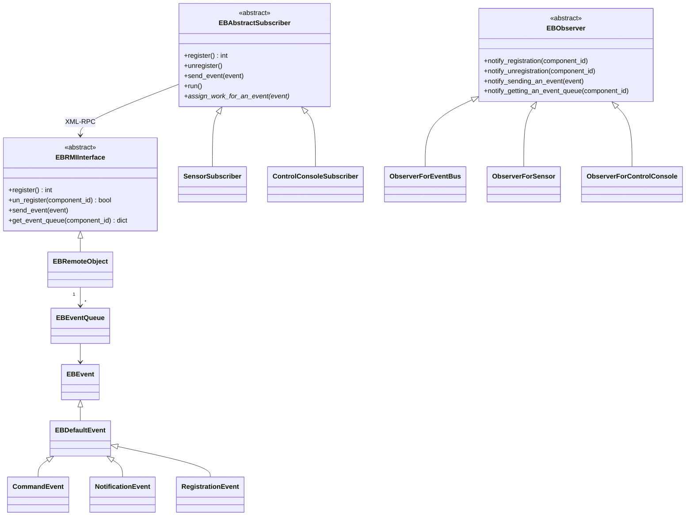

# 빌딩 보안 시스템 – Event Bus (Python)

> Java 구현(`../java/src`)을 Python으로 옮긴 코드입니다. 패키지 구조, 클래스 구성, 화면 메시지는 Java 버전과 같습니다.
> 시스템 설명은 `../빌딩보안시스템_요구사항명세서.pdf`, `../빌딩보안시스템_아키텍처설계서.pdf` 를 참고하세요.

## 1. 시스템 개요

문, 드론, 창문 센서가 **Event Bus** 를 통해 관제 콘솔과 통신합니다. 컴포넌트는 서로를 직접 알지 못하고, 모두 Event Bus에만 연결됩니다.
그래서 새로운 센서를 추가해도 다른 컴포넌트에 주는 영향이 작습니다.



각 컴포넌트는 **별도의 프로세스**입니다. Event Bus Server는 등록된 Subscriber마다 이벤트 큐를 하나씩 두고,
이벤트가 오면 **모든 큐에 삽입**합니다. Subscriber는 1초마다 자기 큐를 회수해서 자신과 관련된 이벤트만 처리합니다.



## 2. 구조



- `template` 폴더 밖이 **EB Framework**, `template` 폴더 안이 그 위에 만든 **빌딩 보안 시스템**입니다.

### 파일 구성

Java 패키지와 같은 폴더 구조이고, 파일 이름만 snake_case로 바꿨습니다. (예: `EBAbstractSubscriber.java` → `eb_abstract_subscriber.py`)

```
python/
├── README.md
├── eb_security_system.py     # 모든 프로세스 실행 (EBSecuritySystem.bat)
├── resource/logo_nipa.gif    # java/resource/logo_nipa.jpg 를 변환
├── common/                   # 상수, 인터페이스, naming.py
│   └── template/             # 시스템 상수, 컴포넌트 타입, gui_loop.py
├── event/                    # 이벤트, 이벤트 큐
│   └── template/             # Command / Notification / Registration 이벤트
├── eventbus/                 # Event Bus Server
│   └── template/             # 서버 설정, Observer, gui/ (Event Bus Monitor)
└── subscriber/               # Subscriber 추상 클래스
    └── template/
        ├── control/          # Control Console (console/, gui/)
        └── sensor/           # 센서 공통, gui/, door/, drone/, window/
```

| Java | Python | 비고 |
|---|---|---|
| Java RMI (`LocateRegistry`, `UnicastRemoteObject`) | `common/naming.py` | `04rmi` 실습과 같은 xmlrpc 방식. 포트 2020, 이름 `Event_Bus` 는 같음 |
| 객체 직렬화(`Serializable`) | `to_dict()` / `from_dict()` | XML-RPC는 기본 자료형만 전달하므로 이벤트와 큐를 dict로 변환 |
| Swing (`JFrame`, `JButton` …) | tkinter (`Toplevel`, `Button` …) | 창 크기, 위치, 문구는 Java와 같음 |
| 다른 스레드에서 Swing 호출 | `common/template/gui_loop.py` 의 `run_later()` | tkinter는 메인 스레드에서만 다뤄야 함 |
| 경보 깜빡임 스레드 | `after()` 로 200ms마다 예약 | 경보를 여러 번 눌러도 깜빡임은 하나만 동작 |
| `synchronized` 메서드 | `threading.Lock` | |
| `Runtime.addShutdownHook` | `atexit` + SIGTERM/SIGINT 처리 | 종료할 때 등록 해제 |
| `newQueue.hashCode()` 로 ID 생성 | 1부터 증가하는 번호 | XML-RPC 정수 범위에 맞고 읽기 쉬움 |
| 큐 회수 실패 시 `NullPointerException` 으로 스레드 종료 | `None` 을 확인하고 반복 종료 | 결과는 같음 (회수 중단) |

Java와 같게 남겨 둔 부분

- `EVENTSENT` 의 앞에 붙은 `이`, `TRESSPASSING` 철자 등 **화면 문구**는 Java 그대로입니다.
- Control Console은 **자신이 등록한 뒤에** 들어온 센서만 목록에 표시합니다. 그래서 Control Console을 먼저 등록해야 합니다.
- `CommandEventID.TURNON`, `NotificationEventID.IDLE` 은 정의되어 있지만 아무도 보내지 않습니다.

## 3. 실행

### 실행 환경

Python 3.8 이상과 **tkinter** 가 필요합니다. 외부 라이브러리는 필요 없습니다.
다음 명령이 오류 없이 끝나야 합니다.

```bash
python3 -c "import tkinter"
```

`ModuleNotFoundError: No module named '_tkinter'` 가 나오면 tkinter를 설치합니다. Homebrew Python은 버전을 맞춰 설치합니다.

```bash
brew install python-tk@3.13   # python3 --version 이 3.13 인 경우
```

### 시작

**`python` 폴더에서** 실행합니다. 창 5개가 뜹니다. (Event Bus Monitor, Control Console, Door, Drone, Window)

```bash
cd python
python3 eb_security_system.py
```

프로세스를 하나씩 실행할 수도 있습니다. 터미널을 나누어 실행하면 분산 구조가 더 잘 보입니다.

```bash
python3 -m eventbus.eb_server_main
python3 -m subscriber.template.control.console.eb_subscriber_main
python3 -m subscriber.template.sensor.door.eb_subscriber_main
python3 -m subscriber.template.sensor.drone.eb_subscriber_main
python3 -m subscriber.template.sensor.window.eb_subscriber_main
```

### 사용 순서

1. Control Console에서 `Register` 를 누릅니다.
2. 각 센서 창에서 `Console` 을 누른 뒤, 열린 관리 콘솔에서 `Register` 를 누릅니다.
   Control Console의 Registered Sensors에 센서가 나타납니다.
3. 관리 콘솔에서 `Alarm Test` 를 누릅니다. 센서 창의 불빛이 빨강/파랑으로 깜빡이고 상태가 `TRESSPASSING!` 으로 바뀝니다.
4. Control Console에서 해당 센서의 `Turn Off` 를 누릅니다. 1초 안에 센서의 경보가 꺼지고 상태가 `IDLE` 로 돌아옵니다.
5. 관리 콘솔에서 `Unregister` 를 누르면 Control Console의 목록에서 센서가 사라집니다.

Control Console 메시지 (ID는 등록 순서에 따라 달라짐)

```
This component is registered: 1
새로운 컴포넌트가 시스템에 등록되었습니다: 2
새로운 컴포넌트가 시스템에 등록되었습니다: 3
새로운 컴포넌트가 시스템에 등록되었습니다: 4
컴포넌트에서 침입이 발생하였습니다!: 4
이The event is sent: 4 is turned off.
한 컴포넌트가 등록해제 되었습니다: 4
```

종료는 터미널에서 Ctrl+C를 누릅니다. 창을 닫으면 그 프로세스만 종료됩니다.

## 4. 실습 아이디어

1. **센서 추가**: `ComponentType` 에 새 센서(예: `CCTV`)를 추가하고, `door` 폴더를 복사해 새 센서를 만들어 보자.
   Event Bus Server와 Control Console의 코드를 고쳐야 하는 곳이 있는지 확인하고 그 이유를 설명해 보자.
2. **이벤트 추가**: 경보를 끈 센서가 `NotificationEventID.IDLE` 을 보내도록 고쳐 보자.
   Control Console은 이미 이 이벤트를 처리할 수 있다. 어느 코드에서 처리하는가?
3. 이벤트는 **모든 큐**에 삽입된다. 센서가 다른 센서의 `TURNOFF` 명령을 무시하는 코드는 어디에 있는가?
   Event Bus Server가 목표 Subscriber의 큐에만 넣도록 하면 무엇이 달라질까?
