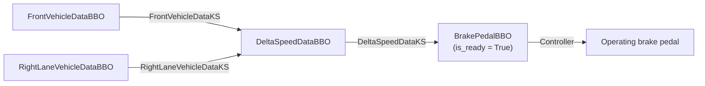
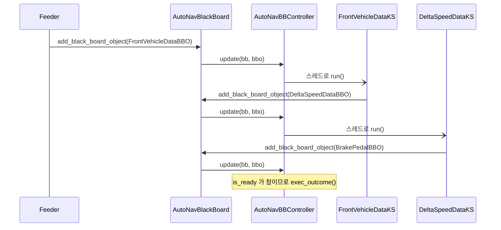
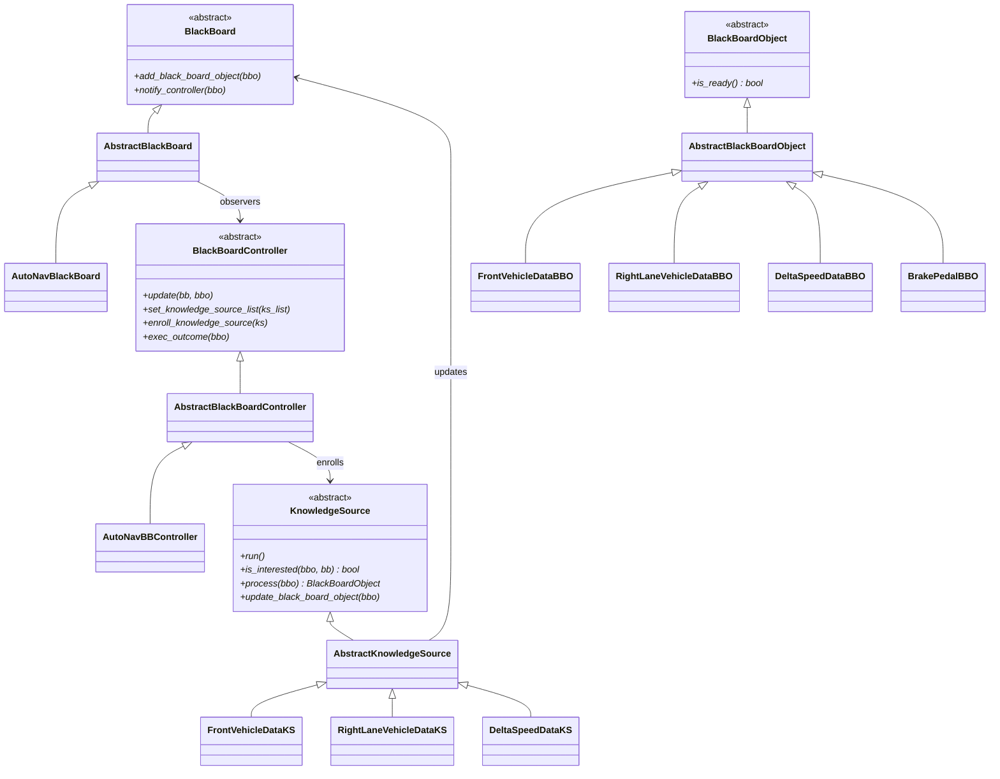

# 자율주행자동차 – Blackboard (Python)

> Java 구현(`../java/src`)을 Python으로 옮긴 코드입니다. 패키지 구조, 클래스 구성, 출력 메시지는 Java 버전과 같습니다.
> 표준 라이브러리만 사용합니다. 원본 Java 코드의 작성자는 Nalla Senthilnathan(http://github.com/mapteb)입니다.

## 1. 시스템 개요

앞 차량과 오른쪽 차선 차량의 센서 데이터가 **Blackboard** 에 올라오면, Knowledge Source가 이를 단계적으로 가공해서
브레이크 페달을 조작하는 결정에 도달합니다. Knowledge Source끼리는 서로를 알지 못하고, Blackboard를 통해서만 결과를 주고받습니다.

- **Blackboard**: 데이터를 받아 Controller에 알린다.
- **Blackboard Object(BBO)**: Blackboard에 올라오는 데이터의 단위. `is_ready` 가 참이면 결정 단계에 도달한 것이다.
- **Knowledge Source(KS)**: 자신이 관심 있는 BBO를 처리해서 새로운 BBO를 만든다.
- **Controller**: 어떤 KS를 실행할지 정하고, 결정 단계에 도달하면 결과를 실행한다.



Controller는 BBO를 받을 때마다 관심 있는 KS를 찾아 **별도의 스레드**로 실행합니다.
KS는 결과를 다시 Blackboard에 추가하고, 그 알림으로 다음 KS가 실행됩니다.



## 2. 구조



- `framework` 폴더가 **Blackboard Framework**, `autonav` 폴더가 그 위에 만든 **자율주행자동차 시스템**입니다.

### 파일 구성

Java 패키지 `rnd.pattern.blackboard` 를 `blackboard` 로 줄였고, 파일 이름은 snake_case로 바꿨습니다.

```
python/
├── README.md
└── blackboard/
    ├── framework/
    │   ├── black_board.py, black_board_object.py          # 인터페이스
    │   ├── knowledge_source.py, black_board_controller.py # 인터페이스
    │   └── abstract_*.py                                  # 공통 구현
    └── autonav/
        ├── auto_nav_black_board_feeder.py                 # 실행 진입점
        ├── bb/auto_nav_black_board.py
        ├── bbo/                                           # BBO 4개
        ├── controller/auto_nav_bb_controller.py
        └── ks/                                            # Knowledge Source 3개
```

Java ↔ Python 차이

| Java | Python | 비고 |
|---|---|---|
| `interface` | `abc.ABC` 와 `@abstractmethod` | |
| `java.util.Observable` / `Observer` | `add_observer()` 와 `update()` 를 직접 구현 | `Observable` 은 JDK 9부터 deprecated |
| `setChanged()` 플래그 | 없음 | 항상 알림 |
| `ExecutorService` (KS마다 스레드 1개짜리 풀) | `threading.Thread` | `enroll_knowledge_source()` 의 `exsvc` 매개변수는 뺌 |
| `instanceof` | `isinstance()` | |
| `getClass().getName()` | `type(bbo).__module__` + `__name__` | 출력되는 클래스 경로만 다름 |

`ThreadPoolExecutor` 대신 `Thread` 를 쓴 이유: `main` 은 약 2초에 끝나지만 KS는 그 뒤에도 다음 KS를 실행합니다.
Python의 `ThreadPoolExecutor` 는 인터프리터 종료가 시작되면 새 작업을 받지 않아서 뒤쪽 처리가 사라집니다.
일반 `Thread` 는 Java의 스레드 풀처럼 모든 스레드가 끝날 때까지 프로세스를 유지합니다.

Java와 같게 남겨 둔 부분

- 하나의 KS 객체가 처리할 BBO를 `is_interested()` 에서 자신의 필드에 저장합니다. (실습 과제 3)
- `process()` 는 메시지만 출력합니다. 실제 속도 계산은 구현되어 있지 않습니다.

## 3. 실행

**`python` 폴더에서** 실행합니다.

```bash
cd python
python3 -m blackboard.autonav.auto_nav_black_board_feeder
```

약 2초 후 종료됩니다. 출력은 24줄이고, 시작 부분은 다음과 같습니다.

```
==>> Blackboard received BBO blackboard.autonav.bbo.front_vehicle_data_bbo.FrontVehicleDataBBO
==>> Blackboard received BBO blackboard.autonav.bbo.right_lane_vehicle_data_bbo.RightLaneVehicleDataBBO
==>> FrontVehicleDataKS processed FrontVehicleDataBBO
==>> Blackboard received BBO blackboard.autonav.bbo.delta_speed_data_bbo.DeltaSpeedDataBBO
==>> Blackboard received BBO blackboard.autonav.bbo.front_vehicle_data_bbo.FrontVehicleDataBBO
==>> DeltaSpeedDataKS processed DeltaSpeedDataBBO
==>> Blackboard received BBO blackboard.autonav.bbo.brake_pedal_bbo.BrakePedalBBO
==>> Operating brake pedal
```

KS가 스레드로 동시에 실행되므로 **출력 순서는 실행할 때마다 조금씩 달라집니다.** Java 버전도 마찬가지입니다.
센서 BBO 4개가 각각 6줄을 출력하고, `Operating brake pedal` 은 항상 4번 출력됩니다.

## 4. 실습 아이디어

1. **Knowledge Source 추가**: 왼쪽 차선 차량을 처리하는 `LeftLaneVehicleDataBBO` 와 `LeftLaneVehicleDataKS` 를 만들고
   `auto_nav_black_board_feeder.py` 에 등록해 보자. `framework` 폴더를 고치지 않아도 출력은 36줄이 되고,
   `Operating brake pedal` 은 6번 출력된다.
2. **실제 판단 넣기**: `FrontVehicleDataBBO`, `RightLaneVehicleDataBBO`, `DeltaSpeedDataBBO` 에 `delta_speed` 값을 넣자.
   KS가 값을 다음 BBO로 전달하고, `DeltaSpeedDataKS` 는 `brake_pedal_bbo.set_ready(bbo.delta_speed < 0)` 으로 판단하게 고쳐 보자.
   Feeder가 첫 번째 `FrontVehicleDataBBO` 에 `-10`, 나머지 BBO에 양수를 넣으면 `Operating brake pedal` 은 1번만 출력된다.
   브레이크를 밟지 않는 `BrakePedalBBO` 는 어떻게 처리되는가?
3. **공유 상태**: `AbstractKnowledgeSource` 는 처리할 BBO를 `self._bbo` 에 저장하고, 스레드는 나중에 이 값을 읽는다.
   같은 KS에 BBO가 연달아 들어오면 어떤 문제가 생길 수 있는가? `is_interested()` 가 상태를 바꾸지 않도록 구조를 고쳐 보자.
   (힌트: `enroll_knowledge_source()` 가 스레드에 BBO를 직접 넘긴다.)
4. `17black` 의 Blackboard와 비교해 보자. 그쪽의 `Control` 은 KnowledgeWorker를 어떻게 선택하고,
   이 실습의 Controller는 어떻게 선택하는가? 어느 쪽이 Knowledge Source를 추가하기 쉬운가?
