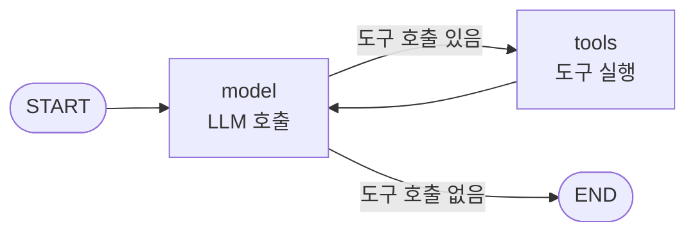
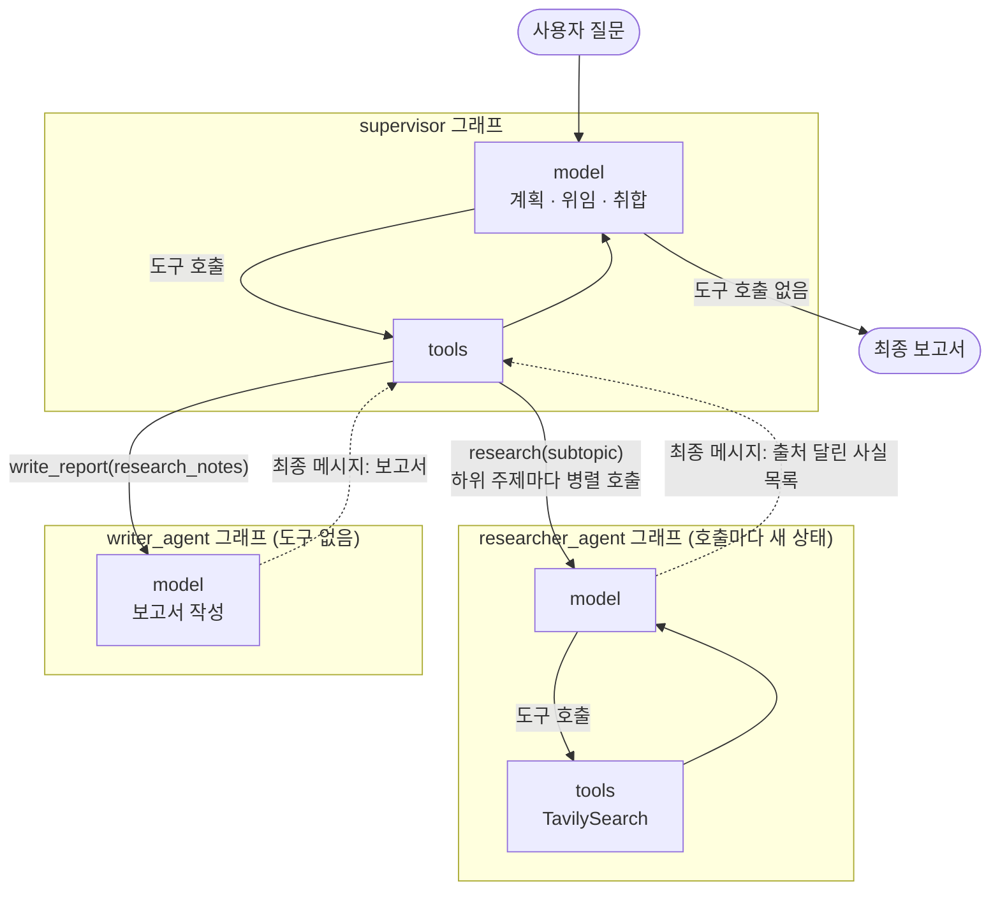
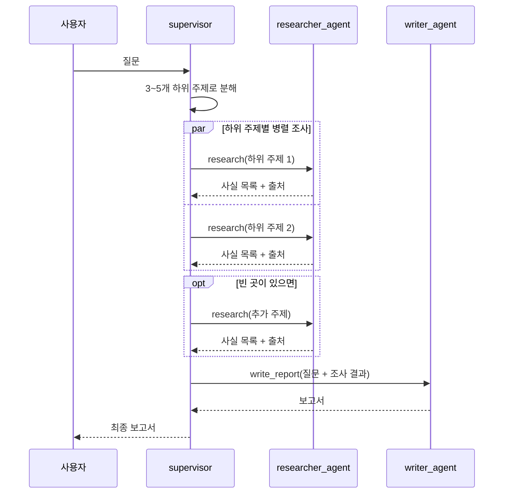

# 리서치 자동화 멀티 에이전트 (Supervisor 패턴)

LangChain/LangGraph의 **Subagents(Supervisor) 패턴**으로 만든 리서치 자동화 예제입니다.
질문 하나를 던지면 총괄 에이전트가 하위 주제로 나누고, 리서처 에이전트들이 웹을 검색한 뒤, 작성자 에이전트가 출처가 달린 한국어 보고서로 정리해 줍니다.

## 구조

```
사용자 → [Supervisor(총괄)] ─┬→ researcher (웹 검색 담당, 병렬 호출 가능)
                             └→ writer     (보고서 작성 담당)
```

| 에이전트 | 도구 | 역할 |
|---|---|---|
| `supervisor` (총괄) | `research`, `write_report` | 질문을 3~5개 하위 주제로 분해 → 리서처에게 위임 → 빈 곳 보충 조사 → 작성자에게 보고서 요청 → 결과 전달 |
| `researcher_agent` | `TavilySearch` (최대 5건) | 하위 주제 하나를 검색어를 바꿔가며 2~3회 이상 검색, 출처 URL이 달린 사실 목록 반환 |
| `writer_agent` | 없음 | 전달받은 자료만 근거로 보고서 작성 (제목 / 요약 3줄 / 본론 / 결론 / 출처 목록). 부족한 부분은 "추가 조사 필요"로 표시 |

핵심 아이디어: 서브에이전트를 `@tool`로 감싸서 총괄 에이전트가 **도구 호출로 일을 맡기도록** 합니다. 서브에이전트는 매번 깨끗한 컨텍스트에서 시작하므로(컨텍스트 격리) 총괄의 대화가 비대해지지 않습니다.

## 그래프 설계 (LangGraph)

코드에서 `langgraph`를 직접 import하지는 않지만, `langchain.agents.create_agent`가 내부적으로 **LangGraph 그래프**를 만들어 돌려줍니다. 따라서 `supervisor`, `researcher_agent`, `writer_agent` 세 개 모두 실제로는 컴파일된 LangGraph 그래프(`CompiledStateGraph`)입니다.

### 에이전트 하나의 그래프

`create_agent`가 만드는 그래프는 세 에이전트 모두 같은 모양입니다. 모델이 도구를 호출하면 도구를 실행하고 다시 모델로 돌아가며, 도구 호출이 없으면 끝납니다.



그래프 상태(state)는 메시지 목록 `{"messages": [...]}`이며, 각 노드가 실행될 때마다 메시지가 하나씩 쌓입니다.

### 전체 그래프 (총괄 + 서브에이전트)

총괄 그래프의 `tools` 노드가 `research` / `write_report` 도구를 실행하면, 그 도구 안에서 서브에이전트 그래프가 **별도의 새 상태로** 실행됩니다(컨텍스트 격리). 총괄에게는 서브에이전트의 최종 메시지 하나만 돌아옵니다.



### 실행 흐름 예시



### LangGraph 기능이 쓰이는 곳

| 코드 | LangGraph 관점 |
|---|---|
| `create_agent(...)` | model ↔ tools 루프 그래프를 만들어 컴파일 |
| `{"messages": [...]}` | 그래프의 입력 상태 |
| `result["messages"][-1]` | 최종 상태에서 마지막 메시지 꺼내기 |
| `supervisor.stream(..., stream_mode="values")` | 노드 실행이 끝날 때마다 전체 상태를 받아 `[위임]` 로그 출력 |

> 이 예제는 흐름 결정을 총괄 모델에게 맡깁니다. 흐름을 코드로 고정하고 싶다면 LangGraph의 `StateGraph`로 "계획 → 병렬 조사 → 작성" 노드와 엣지를 직접 정의하는 방식으로 바꿀 수 있습니다.

## 요구 사항

- Python 3.10 이상 권장
- Anthropic API 키
- Tavily API 키 ([tavily.com](https://tavily.com)에서 무료 발급)

## 설치

```bash
# (선택) 가상환경
python -m venv .venv
source .venv/bin/activate

pip install -U langchain langgraph langchain-anthropic langchain-tavily
```

## 환경 변수 설정

```bash
export ANTHROPIC_API_KEY=your-anthropic-key
export TAVILY_API_KEY=your-tavily-key
```

## 실행

```bash
python research_multi_agent.py
```

실행 중에는 총괄 에이전트가 어떤 서브에이전트에게 무엇을 맡기는지 실시간으로 출력되고, 마지막에 최종 보고서가 출력됩니다.

```
[위임] research ← {'subtopic': '2026년 국내 전기차 배터리 시장 규모와 성장률'}
[위임] research ← {'subtopic': 'LG에너지솔루션의 2026년 전략'}
...
[위임] write_report ← {'research_notes': '원래 질문: ...'}

===== 최종 보고서 =====

(제목 / 요약 / 본론 / 결론 / 출처 목록)
```

> 위 `[위임]` 줄은 예시이며, 실제 하위 주제는 모델이 실행할 때마다 다르게 정합니다.

## 사용자 정의

### 질문 바꾸기

파일 하단 `__main__` 블록의 `question` 값을 원하는 질문으로 바꾸세요.

```python
question = "2026년 국내 전기차 배터리 산업 동향과 주요 기업별 전략을 조사해줘"
```

### 모델 바꾸기

상단의 `MODEL` 값만 바꾸면 세 에이전트 모두에 적용됩니다. 해당 제공사의 `langchain-xxx` 패키지를 추가로 설치해야 합니다.

```python
MODEL = "anthropic:claude-sonnet-5"      # 기본값
# MODEL = "openai:gpt-5.5"               # pip install langchain-openai
# MODEL = "google_genai:gemini-3.6-flash" # pip install langchain-google-genai
```

### 검색 옵션 조정

`max_results`로 검색 1회당 가져올 결과 수를 정합니다.

```python
web_search = TavilySearch(max_results=5)
```

`max_results` 말고도 다음과 같은 옵션이 있습니다([문서](https://scriptagc.wasmer.app/https_docs_langchain_com/docs/integrations/tools/tavily_search)).

- `topic`: 검색 분야를 정합니다. 예: `"general"`
- `search_depth`: 검색 깊이를 정합니다. 예: `"basic"`
- `time_range`: 기간을 제한합니다. 예: `"day"`
- `include_domains` / `exclude_domains`: 특정 사이트만 포함하거나 제외합니다.

```python
web_search = TavilySearch(
    max_results=5,
    topic="general",
    search_depth="basic",
    time_range="day",
    # include_domains=["example.com"],
    # exclude_domains=["example.org"],
)
```

### 최종 결과만 받기 (스트리밍 없이)

진행 상황 출력이 필요 없다면 다음 한 줄로 충분합니다.

```python
report = supervisor.invoke({"messages": [{"role": "user", "content": question}]})["messages"][-1].content
print(report)
```

### 다른 코드에서 가져다 쓰기

```python
from research_multi_agent import supervisor

result = supervisor.invoke({"messages": [{"role": "user", "content": "조사할 질문"}]})
print(result["messages"][-1].content)
```

## 문제 해결

| 증상 | 확인할 것 |
|---|---|
| 인증 오류 (401 등) | `ANTHROPIC_API_KEY`, `TAVILY_API_KEY`가 현재 터미널에 export 되어 있는지 확인 |
| `ModuleNotFoundError` | 설치 명령을 다시 실행하고, 가상환경이 활성화되어 있는지 확인 |
| 다른 모델 사용 시 오류 | 해당 제공사 패키지(`langchain-openai` 등)와 API 키 설정 여부 확인 |
| 실행 시간이 길거나 비용이 큼 | 하위 주제마다 여러 번 검색·모델 호출이 일어납니다. `max_results`를 줄이거나 총괄 프롬프트의 하위 주제 수(3~5개)를 줄여 보세요 |

## 파일 구성

```
41_agent_patterns/
├── research_multi_agent.py   # 멀티 에이전트 예제 본체
└── README.md                 # 이 문서
```
